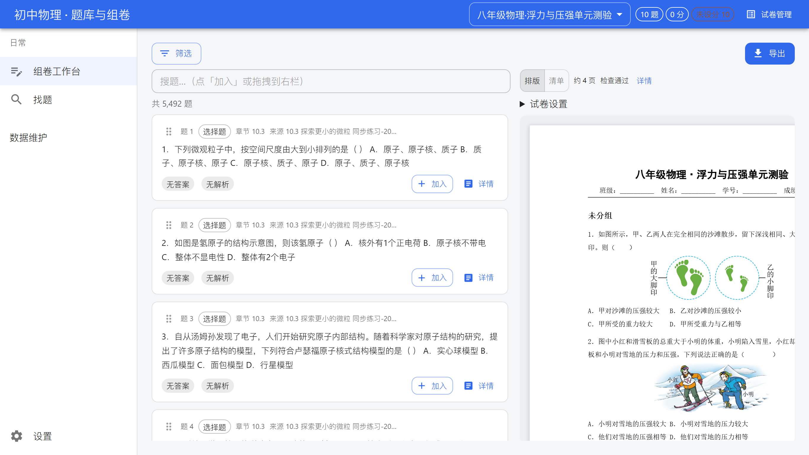
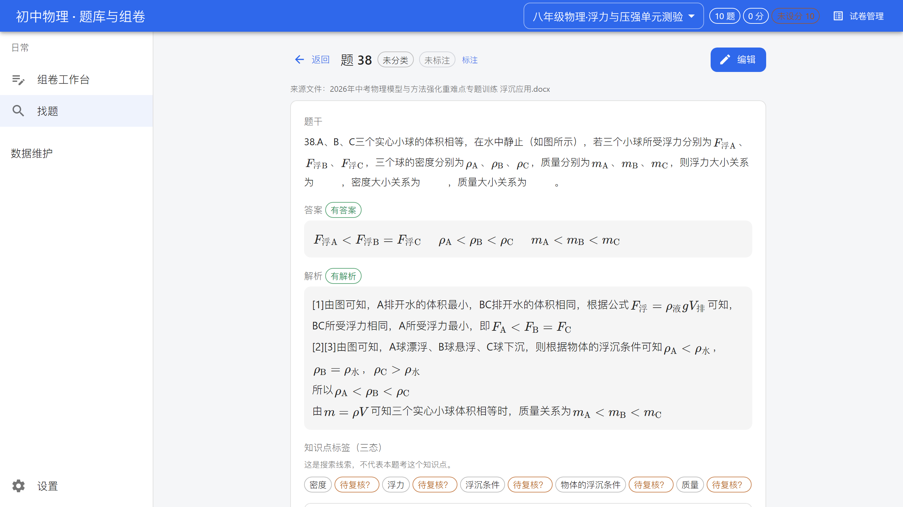
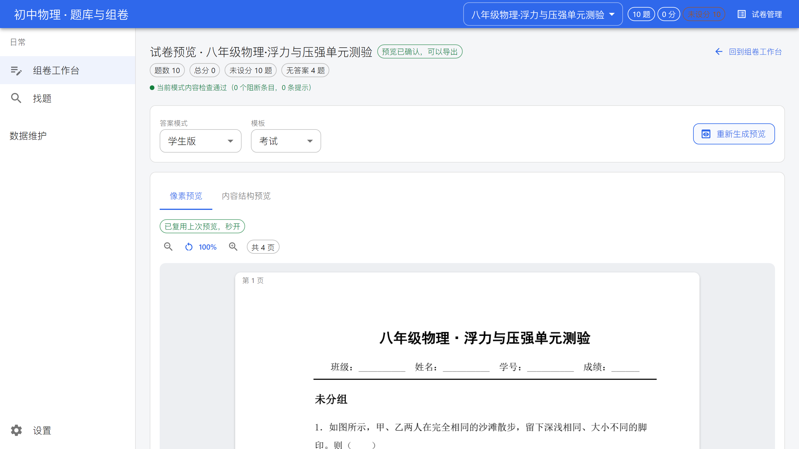
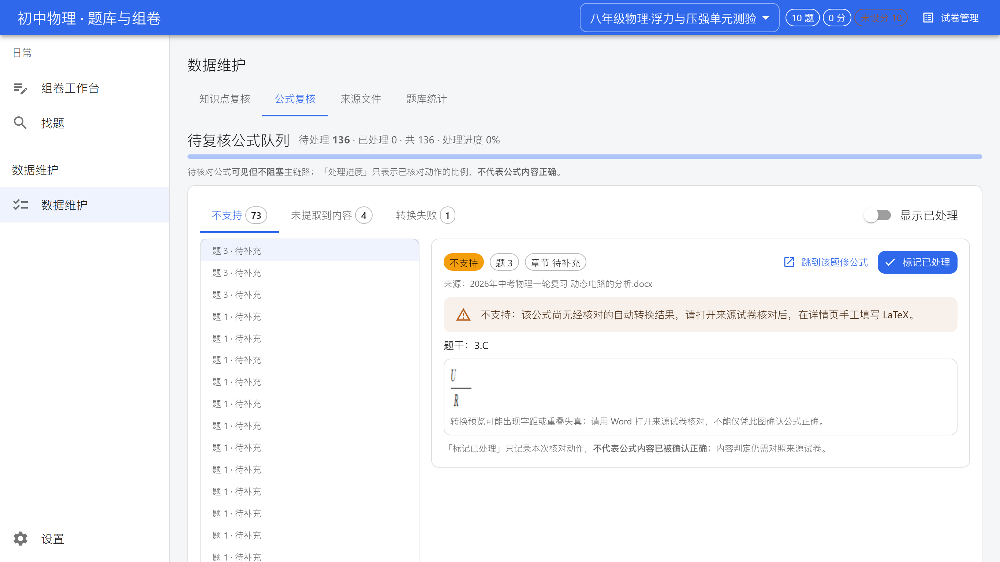
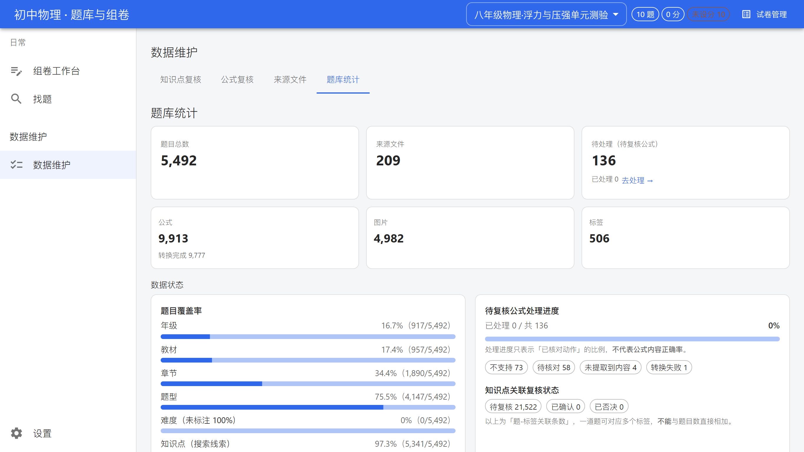
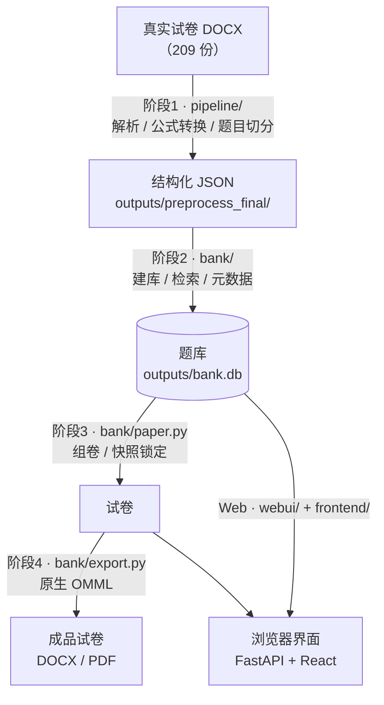

<div align="center">

# 题库管理与组卷系统

**把散落的试卷 Word，变成可搜、可组卷、公式可编辑的私有题库。**

[](#为什么公式可编辑是硬需求)
[](#功能特性)
[](#快速开始)

[快速开始](#快速开始) · [功能特性](#功能特性) · [系统架构](#系统架构) · [常见问题](#常见问题) · [贡献指南](#贡献指南)

</div>



> 组卷工作台 —— 左边找题、右边实时预览 A4 纸面，题号与分值自动排。**这是老师用得最多的一屏。**

---

## 目录

- [这是什么](#这是什么)
- [核心价值](#核心价值)
- [功能特性](#功能特性)
- [快速开始](#快速开始)
- [使用示例](#使用示例)
- [系统架构](#系统架构)
- [技术栈](#技术栈)
- [目录结构](#目录结构)
- [常见问题](#常见问题)
- [贡献指南](#贡献指南)
- [许可证](#许可证)
- [联系方式](#联系方式)

---

## 这是什么

一套**面向中学教师的私有题库管理系统**。把手上零散的试卷 DOCX 变成结构化题库，之后就能：

**搜题 → 组卷 → 导出成品试卷**，全程在浏览器里完成，**不需要联网、不需要云服务**。

首个学科为**初中物理**（已装载 209 份真实试卷），但**内核是学科无关的**——
详见 [学科通用性](#学科通用性)。

> **它不是**在线答题 / 阅卷 / 学情分析平台，也**不做**多人在线协同。
> 它只解决一件事：**让老师快速拿到一张能打印、能在 Word 里继续改的卷子。**

### 为什么公式可编辑是硬需求

这是本项目与绝大多数同类工具**最本质的区别**，也是全部技术难点的来源。

| | 常见做法 | 本项目 |
|---|---|---|
| 公式形态 | 截图 / 图片贴进文档 | **原生 OMML 公式对象** |
| 老师能不能改 | ❌ 只能重新打 | ✅ **在 Word / WPS 里双击直接编辑** |
| 排版会不会乱 | 换字号就错位 | ✅ 跟随文字流 |

源试卷里约 **80%** 的公式是**旧式 MathType OLE 对象**，常规手段只能截图。
本项目用开源库 `mtef-py` 解析 OLE 容器内的 **MTEF 字节流**（**精确解码，不是 OCR**），
转成 LaTeX 再渲染为 **OMML**——**Word 与 WPS 双端原生可编辑，且无需 MathType 授权**。

---

## 核心价值

### 给老师

| 你现在的痛 | 用它会怎样 |
|---|---|
| 翻十几个 Word 文件找一道题 | **中文关键词秒搜**（双字分词 + FTS5 全文索引，不是 `LIKE` 匹配） |
| 手动复制粘贴、题号分值全靠手改 | **点一下加入试卷**，题号/分值/大题自动排 |
| 公式导出来变成图片，改不了 | **导出的公式在 Word 里双击就能改** |
| 改了题库，已出的卷子跟着变 | **试卷有快照锁定**——改题不影响已出的卷 |
| 得装一堆环境、还得联网 | **本地单机运行**，双击一个 `.bat` 就能用 |

### 给开发者

- **学科无关内核**：换学科只需替换「学科专属配置」，不动架构（见 [学科通用性](#学科通用性)）
- **旧式公式迁移方案**：MathType OLE → MTEF → LaTeX → OMML 的完整链路，可作为同类项目的参考实现
- **工程约束是可执行的**：后端 **436** 项测试、前端 **26 + 378** 项测试；
  **对比度门禁 84 组**与**5 个自建前端门禁**都接入了构建流程（见 [开发约定](#开发约定)）

---

## 功能特性

| 能力 | 说明 |
|---|---|
| **DOCX 抽题** | 解析真实试卷，识别题号、大题、选项、公式、图片，自动切分成题 |
| **公式转换** | MathType OLE / OMML → LaTeX；导出时渲染为原生 OMML（Word/WPS 可编辑） |
| **题库检索** | 中文 **bigram + FTS5 + bm25** 排序；支持关键词、章节、知识点、题型、状态多维筛选 |
| **组卷工作台** | 左题库右 A4 预览双栏；拖拽或点击加题、重排、设分、增删大题；**快照锁定** |
| **导出** | DOCX / PDF；像素级预览（所见即所得）；支持「学生版 / 答案解析版」 |
| **数据治理** | 知识点复核（三态）、公式复核、来源文件元数据维护、覆盖率与统计看板 |
| **数据自带出处** | 每道题都能回溯到**来源文件与位置**（可点） |
| **两个版本** | 一个内核 + 两个外壳：**本地运行版**（单人）与**线上部署版**（可选鉴权） |

### 当前数据规模

> 以下为**实测值**（`outputs/bank.db`，2026-10-14）。

| 项 | 数量 |
|---|---|
| 题目 | **5,492** |
| 公式 | **9,913** |
| 图片 | **4,982** |
| 来源试卷 | **209** |
| 知识点标签 | **506**（题-标签关联 **26,678** 条） |

**数据质量如实说明**（不美化）：

- **难度字段 100% 为「未标注」**——源试卷本身没有难度标注，本项目**刻意不编造**，
  因此界面上也不展示这一维度。
- 章节为「待补充」的占 **65.6%**；有答案 **52.4%**、有解析 **58.5%**。
- 知识点是**「提及」口径**（题目文本中出现了该知识点），**不等于「考查」**——
  界面上已明确标注，仅作检索辅助。

---

## 快速开始

### 环境要求

| 项 | 要求 |
|---|---|
| 操作系统 | **Windows**（导出的公式可编辑性依赖 Word / WPS，是 Windows 专有链路） |
| Python | **3.10+**（推荐项目自带的 venv 方式） |
| Node.js | **18+**（仅前端构建需要；已构建过则不需要） |
| Office | **WPS** 或 **Microsoft Word**（导出 PDF 预览时需要） |

### 三步跑起来

```bash
# 1) 安装后端依赖
pip install -r requirements.txt

# 2) 构建前端（产物写入 webui/static/，由后端托管）
cd frontend && npm install && npm run build && cd ..

# 3) 启动
python -m webui
```

浏览器会自动打开 `http://127.0.0.1:8720`。

> **Windows 用户**：也可以直接双击 `editions/local/启动题库.bat`，
> 它会自动做环境自检并打开浏览器。

### 从零建库（可选）

仓库**不附带**试卷源文件。要建立自己的题库：

```bash
# 1) 把试卷 DOCX 放到一个目录，然后跑阶段1 预处理
python -m pipeline.stage1 --input "你的试卷目录" --output outputs/preprocess_final

# 2) 导入题库
python -m bank.cli import outputs/preprocess_final

# 3) 看看结果
python -m bank.cli stats
```

---

## 使用示例

### ① 找题：中文关键词 + 多维筛选


输入「浮力」即可命中相关题目，左侧可按章节、知识点、题型、答案状态筛选。

### ② 看题：题干、公式、答案解析分区展示



单栏 720px 阅读版式；**公式是真实排版而非图片**；答案与解析各自独立区块。

### ③ 组卷：拖拽加题，右栏实时预览


### ④ 导出：先看像素预览，确认后再导出



预览与导出走**同一份文档计划与同一个渲染器**，所见即所得。

### ⑤ 数据治理：公式复核与统计

<table>
<tr>
<td width="50%">


<br><em>公式复核：左队列右详情</em>

</td>
<td width="50%">


<br><em>题库统计：规模与治理进度</em>

</td>
</tr>
</table>

---

## 系统架构



**依赖方向**：`pipeline` → `bank` ← `webui` ← `frontend`
`webui` 只调用 `bank` 的函数，**不复制业务逻辑**。

<details>
<summary><b>各层职责</b>（点击展开）</summary>

| 层 | 目录 | 职责 |
|---|---|---|
| 阶段1 预处理 | `pipeline/` | DOCX 扫描、公式转换（MTEF/OMML → LaTeX）、题目切分 |
| 阶段2 题库 | `bank/` | SQLite schema、导入、检索（FTS5）、元数据补全、媒体 |
| 阶段3 组卷 | `bank/paper.py` | 试卷 CRUD、加题/重排/设分/大题、**快照锁定** |
| 阶段4 导出 | `bank/export.py` | DOCX/PDF 渲染、原生 OMML、像素级预览链路 |
| Web 后端 | `webui/` | FastAPI 应用、API 契约、任务队列 |
| Web 前端 | `frontend/` | React + MUI 界面 |
| 版本外壳 | `editions/` | 本地运行版 / 线上部署版 |

</details>

<details>
<summary><b>类图与导出时序图</b>（点击展开）</summary>

- [`docs/class-diagram.mermaid`](docs/class-diagram.mermaid)
- [`docs/sequence-diagram.mermaid`](docs/sequence-diagram.mermaid)

</details>

### 学科通用性

架构层**与学科无关**——学科差异被收敛到「学科专属配置」中（术语表、知识点体系、
题型定义、元数据字段）。当前**只装载了初中物理素材**。

<details>
<summary><b>接入新学科需要改什么</b>（点击展开）</summary>

1. 新增学科术语表（对照 `frontend/src/lib/glossary.ts` 的模式）
2. 定义该学科的知识点体系与题型集合
3. 调整元数据字段（学段 / 年级 / 教材版本等）
4. 重新跑阶段1 预处理与阶段2 导入

**不需要**改动的是：检索内核、组卷逻辑、导出链路、Web 框架。

</details>

---

## 技术栈

| 层 | 技术 |
|---|---|
| 后端 | Python 3 · **FastAPI** · Uvicorn · **SQLite**（FTS5 全文索引） |
| 前端 | **React 18** · TypeScript · **Vite 5** · **MUI 5** · KaTeX · react-router（HashRouter） |
| 状态 | zustand · TanStack Query |
| 文档处理 | python-docx · `mtef-py`（MathType MTEF 解析）· pypdfium2 |
| 测试 | unittest（后端）· node:test + vitest（前端）· Playwright（端到端） |
| 门禁 | 对比度检查 + 5 个自建前端门禁（见下） |

### 开发约定

```bash
# 后端测试
python -m unittest discover -s tests      # 436 项

# 前端：类型检查 / 测试 / 构建（含对比度门禁）
cd frontend && npx tsc --noEmit
cd frontend && npm test                   # 26 node:test + 378 vitest
cd frontend && npm run build

# 5 个自建前端门禁
cd frontend && npm run gate:all
```

**5 个自建门禁**（`frontend/scripts/`）——把已发生过的缺陷固化成规则：

| 门禁 | 抓什么 |
|---|---|
| `gate:colors` | `sx` / `style` 里的硬编码颜色 |
| `gate:runtime` | 以**运行期存值**（`settings.json` 主色）重算对比度 |
| `gate:duplicate` | 同一数值在一行内重复渲染 |
| `gate:dark` | 深色模式下「文字色 == 背景色」（含 alpha 合成） |
| `gate:late` | 切换上下文后，**迟到的异步响应覆盖新状态** |

> 退出码 `2` = **「无法判定」**（如服务未启动），**既不算通过也不算失败**——
> 这是刻意的设计，避免门禁在无法判定时给出假绿灯。

---

## 目录结构

```
.
├── pipeline/              # 阶段1：DOCX 解析、公式转换、题目切分
├── bank/                  # 阶段2/3/4：题库、检索、组卷、导出
│   ├── db.py              #   连接与 schema
│   ├── query.py           #   检索（bigram + FTS5 + bm25）
│   ├── paper.py           #   组卷与快照锁定
│   ├── export.py          #   导出（原生 OMML）
│   ├── mtef_conv.py       #   MathType MTEF → LaTeX
│   └── cli.py             #   命令行入口
├── webui/                 # Web 后端（FastAPI）
│   ├── app.py             #   应用工厂 + 静态托管
│   ├── routers/           #   按资源划分的路由
│   └── services/          #   业务层（调用 bank/）
├── frontend/              # Web 前端（React + MUI）
│   ├── src/pages/         #   10 个页面
│   ├── src/components/    #   共享组件（含四态组件）
│   ├── src/theme.ts       #   设计 token 唯一来源
│   └── scripts/           #   对比度检查 + 5 个自建门禁
├── editions/              # 版本外壳：local（本地）/ online（线上）
├── tests/                 # 后端测试
├── docs/                  # 架构图与截图
├── outputs/               # 数据产物（题库、导出件、备份）※ 不入库
└── deliverables/          # 设计规范、评审报告、任务表
```

---

## 常见问题

<details>
<summary><b>导出的公式真的能改吗？</b></summary>

能。导出的是**原生 OMML 公式对象**，不是图片。在 Word / WPS 里**双击公式即可编辑**。
这是本项目的核心目标，也是验收硬标准——**公式图片不算达标**。

</details>

<details>
<summary><b>为什么难度字段全是「未标注」？</b></summary>

因为**源试卷里本来就没有难度标注**。本项目**刻意不编造**数据，
所以界面上也不展示这一维度——而不是随便填一个值让它「看起来完整」。

</details>

<details>
<summary><b>知识点能当「考点」用吗？</b></summary>

**不能。** 知识点是**「提及」口径**——指题目文本中出现了该知识点，
**不等于这道题考查了它**（平均每道题命中 4.26 个标签）。
界面上已明确标注这一点，仅作**检索辅助**。

</details>

<details>
<summary><b>为什么按年级筛选会漏题？</b></summary>

因为约 **65.6%** 的题章节为「待补充」，年级/教材元数据也有较多缺失。
界面在筛选时**会显式提示漏题数量**，不会静默少给结果。

</details>

<details>
<summary><b>可以换成别的学科吗？</b></summary>

可以。内核与学科无关，见 [学科通用性](#学科通用性)。
当前仓库只装了初中物理素材，需要自备该学科试卷并重跑预处理。

</details>

<details>
<summary><b>能在 macOS / Linux 上跑吗？</b></summary>

Web 界面可以。但**「导出公式可编辑」这条链路依赖 Windows 上的 Word / WPS**，
因此完整功能建议在 Windows 上使用。

</details>

<details>
<summary><b>需要联网吗？</b></summary>

不需要。默认是**本地单机运行**，只监听 `127.0.0.1`，不对外暴露。

</details>

<details>
<summary><b>能把界面给同事用吗？</b></summary>

可以，`editions/online/` 提供了线上部署版（可开启鉴权）。
⚠️ 但请注意其已知限制：**并发导出是串行的**，且鉴权仅为访问控制级。

</details>

---

## 贡献指南

**先读 [`AGENTS.md`](AGENTS.md)** —— 它是本项目的开发总控文档，包含角色分工、
三个硬门禁（契约冻结 / 证据门槛 / 独立性门槛）与必须遵守的工程约定。

几条**踩过坑总结的硬规则**（详见 `AGENTS.md` §5）：

- **改排版/导出后必须渲染出来看**——单元测试测不出视觉缺陷
- **验证「修复类改动」要用反证**——不是「跑个测试通过」，而是确认修复前确实有问题
- **指标必须用 SQL 核实真实含义**——曾把「提及」当成「考查」汇报
- **文档/注释里的数字必须与实测一致**——本文件所有数字均标注了实测来源
- **不要修改 `outputs/bank.db`**；写入类验证必须用副本

### 提交前自检

```bash
python -m unittest discover -s tests           # 后端 436 项
cd frontend && npm test && npm run build       # 前端测试 + 构建 + 对比度门禁
cd frontend && npm run gate:all                # 5 个自建门禁
```

### 提交规范

- **中文 commit message**，说明：改了什么、实测证据、哪些没做
- **一个逻辑改动一个提交**；不要顺手重构无关代码
- **如实报告**：做不到就明确说，不要把它说成已完成

---

## 许可证

⚠️ **本仓库当前尚未附加许可证**（未声明即默认保留所有权利）。

在添加明确的许可证之前，请**不要**假定可以自由复制、修改或分发本项目的代码与数据。

> 如需开源，建议在 `LICENSE` 文件中明确选择一种（如 MIT / Apache-2.0），
> 并更新本节。注意本项目依赖 `mtef-py`（Apache-2.0），选择许可时需保持兼容。

---

## 联系方式

- **问题反馈 / 功能建议**：请提 [GitHub Issues](https://github.com/Soapman233/Localtopic-management/issues)
- **代码**：[github.com/Soapman233/Localtopic-management](https://github.com/Soapman233/Localtopic-management)

---

<div align="center">

**本项目所有数据统计均为实测值，未做美化。**
文档与实现不一致时，以 `AGENTS.md` 与实测输出为准。

</div>
