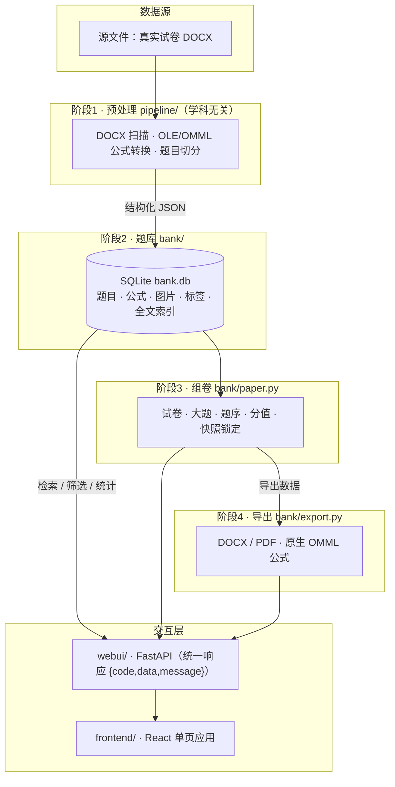
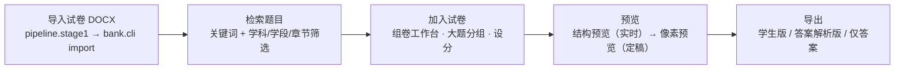

# 题库管理与组卷系统 · 跨学科通用组卷平台

> 把真实试卷 DOCX 变成**可检索、可组卷、可导出**的私有题库：从 Word 里抽题建库 → 检索筛选 → 组卷 → 导出**公式可编辑**的成品试卷 → 本地 Web 界面操作。
>
> **本平台是面向所有学科通用的组卷平台**：数据库 schema、检索、组卷、导出与公式转换**均不绑定任何学科**。当前已装载的素材为**初中物理**；接入其它学科只需替换「学科专属配置」并导入对应学科的试卷（详见 [学科通用性说明](#学科通用性说明)）。
>
> **核心难点**：源试卷里的数学公式是**旧式 MathType OLE 对象**，必须转换成**原生 OMML**，才能保证导出的 DOCX 在 **Microsoft Word 与 WPS 双端都可编辑**。该能力同样与学科无关。

面向约 10 名中学教师设计，覆盖多学科备课与组卷场景。

项目按运行形态分为**两个版本**（**共享同一套内核**，业务代码零分叉）：

| 版本 | 定位 | 入口 |
|---|---|---|
| **本地运行版** | 一名老师在自己电脑上用；仅监听 `127.0.0.1`，无账号 | [`editions/local/`](editions/local/README.md) |
| **线上部署版** | 局域网 / 服务器上多人共用；`0.0.0.0` + nginx 访问控制 | [`editions/online/`](editions/online/README.md) |

> 分类总览与切换方式见 [`editions/README.md`](editions/README.md)。

---

## 目录

- [项目简介](#项目简介)
- [学科通用性说明](#学科通用性说明)
- [核心功能](#核心功能)
- [系统架构](#系统架构)
- [使用方法](#使用方法)
- [数据与初始化](#数据与初始化)
- [目录结构](#目录结构)
- [测试](#测试)
- [已知限制](#已知限制)
- [开发约定](#开发约定)
- [文档索引](#文档索引)
- [许可证](#许可证)

---

## 项目简介

**一句话定位**：一个**跨学科通用的私有题库与组卷平台**，把教师手上的真实试卷（Word）沉淀为结构化题库，支持按学科、学段、章节、题型、关键词检索，挑选题目组成新试卷，并导出**公式可编辑**的成品卷。

**解决什么问题**

| 痛点 | 本平台的解法 |
|---|---|
| 试卷散落在成百上千个 Word 文件里，找一道题要翻半天 | 一次性建库，毫秒级中文关键词检索 + 多维筛选 |
| 旧式 MathType 公式无法在 Word/WPS 里编辑，复制即变图片 | 内置 MTEF 解析器**精确解码**（非 OCR），导出为**原生 OMML** |
| 手动复制粘贴组卷，题号、分值、排版反复出错 | 组卷工作台 + 分值管理 + **快照锁定** + 结构化/像素双层预览 |
| 出卷后题库里的题被改动，已出的卷跟着变 | 组卷时锁定**题目版本与内容快照**，改题不影响已出卷 |
| 学科之间工具割裂，换学科就得换系统 | 内核学科无关，接入新学科只需替换学科配置 |

**目标用户**：约 10 名中学教师（**跨学科**），以教研组为单位备课、组卷、出练习与考试卷。

---

## 学科通用性说明

> 本章回答一个关键问题：**这套系统是「只能做物理」还是「什么学科都能做」？**
> 结论：**架构层学科无关，当前只装载了物理素材；接入其它学科需要替换「学科专属配置」，不需要改动内核代码。**

### 一、证据：架构层确实是学科无关的

下列事实均已在代码中核实（含文件与关键位置）：

| 维度 | 证据 | 位置 |
|---|---|---|
| **数据模型** | `source_files` 表含 `stage`（学段）+ `subject`（学科）字段；`papers` 表同样含 `subject` + `stage` | `bank/db.py` |
| **学科词表覆盖 10 个学科** | 物理 / 化学 / 数学 / 生物 / 地理 / 历史 / 政治 / 道德与法治 / 英语 / 语文 | `bank/metadata.py:30` `_SUBJECTS` |
| **词表确实被使用** | 从文件名 / 标题 / 源路径自动识别学科 | `bank/metadata.py:131` `_first_match(src, _SUBJECTS)` |
| **教材词表跨学科** | 20 个教材版本，**含英语教材**（外研版 / 译林版 / 牛津版 / 人教新目标等） | `bank/metadata.py` `_TEXTBOOKS` |
| **题型规则通用** | 选择题 / 填空题 / 实验探究题 / 计算解答题 / 作图题 / 简答题 / 判断题等，非物理专属 | `bank/metadata.py:39` `_SECTION_TYPE_RULES` |
| **检索支持按学科筛选** | `stage` / `subject` 可作为筛选条件，并进入 facets 计数 | `bank/query.py`（`_build_where` / `search` / `facets`） |
| **阶段1 预处理学科无关** | DOCX 扫描、OLE/OMML 公式转换、题目切分不涉及学科语义 | `pipeline/` |
| **组卷 / 导出 / 检索 / 留版 / 复核学科无关** | 各模块只处理「题目 / 试卷 / 公式 / 图片」，不判断学科 | `bank/paper.py`、`bank/export.py`、`bank/query.py`、`bank/edit.py`、`bank/review.py` |

**一句话**：内核里没有任何一处「如果是物理就……否则……」的学科分支逻辑。

### 二、现状：当前只装载了物理素材

| 项 | 实测值 |
|---|---|
| 源文件总数 | **209 份** |
| 其中 `subject = 物理` | **209 / 209（100%）** |
| 其中 `stage = 初中` | **209 / 209（100%）** |
| 题目总数 | **7,945 道**（全部来自上述物理源文件） |

> 也就是说：**平台「能装」任何学科，但目前只装了物理。** 界面上按学科筛选当前只会出现「物理」一个取值，这是**数据现状**而非**能力上限**。

### 三、边界：接入新学科需要替换「学科专属配置」

「通用」不等于「开箱即用支持所有学科」。当前仍有以下**学科专属配置**，接入新学科时必须处理：

| 类别 | 内容 | 位置 | 处理方式 |
|---|---|---|---|
| **学科识别默认值** | 从文件名 / 标题 / 路径**无法识别学科时，默认判为「物理」** | `bank/metadata.py` `detect_subject()`（`return "物理"`） | 接入新学科前改为「未知 / 待补充」，否则该学科**无法识别的题会被错误标为物理** |
| **知识点词典** | 一份**物理**知识点词表（力学 / 热学 / 声学 / 光学 / 电学等） | `bank/enrich.py` `KNOWLEDGE_TERMS` | 替换为该学科的概念词表 |
| **教材章节映射** | **人教版 / 苏科版初中物理**的「章节号 → 年级」映射表 | `bank/enrich.py` `RENJIAO_GRADE_RANGES` / `SUKE_GRADE_RANGES` | 替换为该学科各教材版本的章节映射 |
| **界面标题（硬编码）** | 顶栏与文档标题写死为「初中物理 · 题库与组卷」 | `frontend/src/app/routeMetadata.ts`、`frontend/src/App.tsx` | 改为可配置（建议按 `subject`/`stage` 动态生成） |

> ⚠️ **如实说明**：界面标题当前是**硬编码**的，接入新学科后不会自动变化，需要改为可配置项（见 [待确认问题](#待确认问题)）。

### 四、接入新学科的步骤清单


| 步骤 | 操作 | 是否需改代码 |
|---|---|---|
| 1 | 准备该学科的试卷 DOCX，放入资料目录 | 否 |
| 2 | 替换 `enrich.KNOWLEDGE_TERMS`（知识点词典）与 `TEXTBOOK_GRADE_MAPS`（章节映射） | **是**（配置常量） |
| 3 | 按需扩展 `metadata._SUBJECTS` / `_TEXTBOOKS`，并把 `metadata.detect_subject()` 的默认值由「物理」改为「未知 / 待补充」 | **是** |
| 4 | 把界面标题改为可配置（当前硬编码） | **是**（前端） |
| 5 | 运行 `python -m pipeline.stage1 <试卷目录> --out outputs/preprocess_final` | 否 |
| 6 | `bank.cli init` → `import` → `enrich` → `normalize` | 否 |
| 7 | 检索、组卷、导出、留版、复核直接可用 | **否** |

> **跨学科对照示例（说明「同一内核处理不同学科」）**
>
> | 学科 | 一道典型题 | 内核如何处理（学科无关） |
> |---|---|---|
> | 物理 | 计算物体所受浮力，含 `F = ρgV` 公式 | 公式转 LaTeX/OMML，题干切分入库 |
> | 化学 | 配平化学方程式，含下标与箭头 | 同上（下标、箭头均为公式/文本，无学科分支） |
> | 数学 | 解一元二次方程，含根式与分式 | 同上（根式、分式为公式） |
> | 英语 | 完形填空，含选项 A/B/C/D | 题型规则识别「选择题」，题干切分入库 |
>
> 四个例子走的是**完全相同的代码路径**——差别只在导入的素材与学科配置。

---

## 核心功能

按处理链路分为六大模块。所有模块的**功能描述均与学科无关**。

| 模块 | 能力 |
|---|---|
| **① 阶段1 预处理** | 扫描试卷 DOCX，定位 OLE/OMML 公式与图片；**MathType MTEF → LaTeX** 精确解码（非 OCR）；题目切分与整卷答案区识别 |
| **② 阶段2 题库** | SQLite（11 张业务表 + FTS5）；幂等导入；**中文 bigram + FTS5 + bm25** 检索（毫秒级）；题目版本留档；待复核队列 |
| **③ 阶段3 组卷** | 试卷 CRUD、加题、重排、分值、大题分组；**快照锁定**（出卷后改题不影响已出卷） |
| **④ 阶段4 导出** | 学生版 / 答案解析版 / 仅答案 × DOCX/PDF × 考试/测验/作业三种模板；公式为**原生 OMML**；图片尺寸自适应；页脚页码；真实制表位选项对齐 |
| **⑤ Web 界面** | 10 个功能页面：检索 / 单题详情 / 组卷工作台 / 导出中心 / 知识点复核 / 公式复核 / 来源文件 / 题库统计 / 数据维护 / 系统设置（+ 线上部署版登录页）；**强制先预览后导出**的门禁 |
| **⑥ 数据治理** | 元数据保守补全（记录来源 provenance）；知识点人工复核三态；公式复核队列；**内容守卫**（答案区误切阻断出卷） |

### ① 阶段1 预处理（`pipeline/`）

- 把真实试卷 DOCX 转成**结构化 JSON**：题干（公式位置替换为 `⟦Fn⟧` 占位符）、公式索引、图片、来源定位。
- **三类公式统一成 LaTeX**：原生 OMML 直接转换；旧式 MathType OLE 对象经内置解析器**精确解码**；扫描件不在本阶段。
- **超时隔离**：MTEF 解析器在极少数畸形公式上会死循环，整批在独立进程运行并设截止时间，**把坏公式隔离成一条 TIMEOUT，而不是拖垮整份文件**。
- **失败进队列**：任何非 `OK` 的公式都带 `needs_review`，进人工队列，**绝不静默丢弃**。
- 全程**只读**源文件，不修改输入。

### ② 阶段2 题库（`bank/`）

- **SQLite 单文件**，11 张业务表 + FTS5 全文索引，不引入 ORM、不引入外部数据库。
- **幂等导入**：源文件按 `sha256` 唯一，题目按 `(source_id, content_hash)` 唯一，重复导入新增 0、更新 0；**单文件导入是原子事务**（失败 `rollback()`）。
- **中文检索**：题干在导入时切成**双字词元**（bigram）存入 FTS5，查询串同样切分后 `MATCH`，按 `bm25` 排序；单字查询退化为 `LIKE`。
  - *为什么不用 trigram*：trigram 要求查询串至少 3 字符，而中文里「浮力」「压强」「密度」等**双字词**会直接失效。
  - *为什么不用自建倒排*：双字切分后直接复用 FTS5 的倒排与 BM25，代码更少、更快。
- **题目版本**：`questions.version` + `question_versions` 保存每一版原文，组卷据此锁定版本。
- **多维筛选与统计**：学段 / 学科 / 年级 / 教材 / 章节 / 题型 / 难度 / 大题，含「待补充」缺失桶与覆盖率统计。

### ③ 阶段3 组卷（`bank/paper.py`）

- 试卷 / 大题 / 条目三级模型；加题、删题、重排、设分、大题分组。
- **快照锁定**：加题时记录 `question_version`，并把题干 / 公式 / 图片 / 答案 / 解析写入 `snapshot_json`。**之后题库里该题被修改，已建试卷内容不变**——导出只读快照。
- **题序连续**：`seq` 全卷 1..n 连续无空洞，删除 / 移动 / 插入后自动重排。
- **分值校验**：合法范围 `[0, 1000]`，允许 0（占位）与小数（如 0.5 分），拒绝负数 / 超大值 / 非数字，非法值明确报错（不静默 clamp）。
- 允许同一道题在同一份试卷里出现多次（`paper_questions` 对 `(paper_id, question_id)` 不加唯一约束）。

### ④ 阶段4 导出（`bank/export.py`）

- 三种答案形态：**学生版 / 答案解析版 / 仅答案**；三种模板：**考试 / 测验 / 作业**；输出 **DOCX**（公式可编辑）与 **PDF**（打印对照）。
- **公式 = 原生 OMML**：LaTeX 经本地 `editor_sdk` 桥接写入；`⟦Fn⟧` 占位符**按 `fid` 精确映射**（不按出现顺序），题干与解析共用同一映射表，不会串位。
- **中文公式**：`\text{[U+XXXX]}` 统一转为 `\text{汉字}`（**在已有 `\text{}` 内替换**）。
- **题号处理**：导出按全卷连续重新编号，并剥离题干行首的原卷题号，避免双重题号。
- **图片**：从源 DOCX 包内按 `word/<media_path>` 取出并校验 `sha256`，尺寸自适应，居中附在题干之后。
- **只读导出**：走只读连接，**不触发 schema 迁移、不改动 `bank.db`**。
- **双端验证**：`export verify` 在 Word 与 WPS 中分别打开导出件，**逐个公式改一个内部字符 → 保存 → 重开 → 比对**，以证明公式可编辑（而非「有 OMML 节点」的间接证据）。

### ⑤ Web 界面（`webui/` + `frontend/`）

- **后端 FastAPI**：统一返回 `{code, data, message}`；错误码分段（参数 / 未授权 / 权限 / 不存在 / 冲突 / 环境）。实测 **49 个路径 / 56 个操作**。
- **前端 Vite + React + TypeScript + MUI + KaTeX**：路由级代码分割（页面按需加载）。
- **双层预览**：
  - **结构预览**（`LivePreviewPanel`）：前端实时渲染 A4 近似排版，可拖拽 / 改分 / 删除；
  - **像素预览**（后端渲染，数秒）：导出前定稿用。
- **强制预览门禁**：任何内容变更都会重新锁定导出；环境降级（无 Word/WPS）时以结构预览确认替代，避免锁死 DOCX 导出。
- **内容守卫**：答案区误切条目会**阻断出卷**并给出逐条诊断，提供「查看修订候选 → 创建修订卷」的显式闭环。

### ⑥ 数据治理

- **元数据补全**（`bank/enrich.py`）：在**不编造、不覆盖**的前提下，从文件名 / 源路径 / 章节号 / 题干保守推断 `grade` / `textbook` / `chapter` / 知识点，并为每个值记录来源（provenance）。**难度一律不猜**（源数据无标注，保持 `未标注`）。
- **知识点复核**（`bank/labels.py`）：知识点标签为「**提及**」口径（题干出现该词即打标，**不代表考查范围**），提供 `待复核 / 已确认 / 已否决` 三态与 CSV 导入导出，交由教研组人工确认。
- **公式复核**（`bank/review.py`）：非 `OK` 公式进待复核队列，逐条人工处理。
- **备份校验**（`enrich.backup_db` / `verify_backup`）：改库前备份，并校验备份是否为**合格回滚点**。

---

## 系统架构

### 分层总览



### 依赖方向

```
pipeline  →  bank  ←  webui  ←  frontend
```

- `pipeline` 只产出结构化 JSON，不依赖 `bank`；
- `webui` **只调用 `bank/` 的函数，不复制业务逻辑**；
- `frontend` 只通过 HTTP API 访问后端，不直接读数据库。

### 各层职责

| 层 | 目录 | 职责 |
|---|---|---|
| 预处理层 | `pipeline/` | DOCX 解析、公式转换、题目切分、答案区识别 |
| 领域层 | `bank/` | 数据模型、导入、检索、组卷、导出、编辑留版、复核、元数据治理 |
| 接口层 | `webui/` | FastAPI 路由 + 服务层（薄封装 `bank/`）+ 后台任务串行化 |
| 界面层 | `frontend/` | 页面、组件、状态管理、导出门禁 |
| 版本外壳 | `editions/` | 本地运行版 / 线上部署版的启动与部署产物（业务代码零分叉） |

### 技术栈

| 层 | 技术 |
|---|---|
| 预处理 / 领域 | Python 3.13，标准库 `sqlite3` / `zipfile` / `hashlib`；`olefile` 读 OLE；内置 `mtef_py`（Apache-2.0） |
| 后端 | FastAPI + uvicorn + Pydantic；统一响应契约 |
| 前端 | Vite 5 + React 18 + TypeScript + MUI 5 + KaTeX + Zustand + React Router |
| 导出 | `editor_sdk` 桥接（LaTeX → OMML）+ `pywin32`（Word/WPS COM 自动化）+ `pypdfium2`（PDF 转像素预览） |
| 数据库 | SQLite 单文件 + FTS5 全文索引 |

### 关键设计

| 设计 | 说明 |
|---|---|
| **快照锁定** | 组卷时把题目内容写入 `snapshot_json` 并记录 `question_version`，改题不影响已出卷 |
| **原生 OMML** | 公式以 OMML 写入 DOCX（非图片），Word/WPS 双端可编辑 |
| **双层预览 + 强制门禁** | 结构预览（实时）+ 像素预览（定稿）；内容变更即锁定导出 |
| **学科无关内核** | schema / 检索 / 组卷 / 导出 / 公式转换均不含学科分支逻辑 |
| **只读安全边界** | 导出 / 预览 / 检索走只读连接，不改动交付库 |
| **占位符保序** | 题干公式位置写 `⟦Fn⟧`，保证切分与重组时公式不串位 |

---

## 使用方法

### 环境要求

| 项 | 要求 |
|---|---|
| 操作系统 | **Windows**（导出 / 预览依赖本机 Word 或 WPS 的 COM 自动化） |
| Python | 3.13（实测 3.13.x） |
| Node.js | 20+（实测 22.x），仅前端构建需要 |
| Office | Microsoft Word 或 WPS（导出 PDF / 像素预览需要；缺失时降级为仅导出 DOCX） |
| 其它 | 导出依赖本机 `editor_sdk` 服务（LaTeX → OMML 渲染） |

### 安装

```bash
# 1) Python 依赖
python -m venv .venv
.venv\Scripts\activate
pip install -r requirements.txt

# 2) 前端依赖与构建（产物写入 webui/static/，由后端托管）
cd frontend
npm install
npm run build
cd ..
```

### 启动

```bash
# 方式一：一键启动（本地运行版；Windows，自动做环境自检并打开浏览器）
editions\local\启动题库.bat

# 方式二：手动
python -m webui

# 方式三：线上部署版（监听 0.0.0.0；浏览器访问请置于 nginx 之后）
set QB_EDITION=online && set QB_HOST=0.0.0.0 && python -m webui
```

启动后访问 `http://127.0.0.1:8720`（线上版为 `http://<服务器IP>/`）。

> ⚠️ `editions/local/启动题库.bat` **必须保持 CRLF 换行**（LF 会让 cmd 解析失败、脚本一闪即退），仓库已用 `.gitattributes` 锁定。

### 典型工作流（导入 → 检索 → 组卷 → 预览 → 导出）



| 步骤 | Web 界面 | 命令行 |
|---|---|---|
| 建库 | — | `python -m bank.cli init --db outputs/bank.db` |
| 预处理 | — | `python -m pipeline.stage1 <试卷目录> --out outputs/preprocess_final` |
| 导入 | — | `python -m bank.cli import outputs/preprocess_final --db outputs/bank.db` |
| 检索 | 找题页 | `python -m bank.cli search "浮力" --subject 物理 --chapter 9.4` |
| 组卷 | 组卷工作台 | `python -m bank.cli paper add 1 3753 3754 --section "一、选择题" --score 3` |
| 预览 | 导出中心（强制先预览） | — |
| 导出 | 导出中心 | `python -m bank.cli export paper 1 --answer-mode 学生版 --out out.docx` |
| 校验公式 | — | `python -m bank.cli export verify out.docx` |

### 常用命令

```bash
# 后端全量测试
python -m unittest discover -s tests

# CLI
python -m bank.cli stats                     # 题库统计
python -m bank.cli search "浮力"             # 检索
python -m bank.cli paper show 1              # 查看试卷
python -m bank.cli export paper 1 --answer-mode 学生版 --out out.docx
python -m bank.cli export verify out.docx    # 验证公式双端可编辑性（Word+WPS）

# 前端
cd frontend && npx tsc --noEmit              # 类型检查
cd frontend && npm test                      # 前端回归
cd frontend && npm run build                 # 生产构建
```

---

## 数据与初始化

> **本仓库不包含源试卷、题库数据与中间产物**（体积达 GB 级，且源试卷为第三方资料）。
> 仓库只跟踪**源码、文档、测试与配置**。克隆后需按下述步骤自行准备数据。

```bash
# 1) 建库（建表建索引）
python -m bank.cli init --db outputs/bank.db

# 2) 阶段1：把试卷 DOCX 转成结构化 JSON
python -m pipeline.stage1 <你的试卷目录> --out outputs/preprocess_final

# 3) 阶段2：导入题库（幂等，可重复执行）
python -m bank.cli import outputs/preprocess_final --db outputs/bank.db

# 4) 可选：抽取答案/解析、补全元数据、规范化 LaTeX
python -m bank.cli answers   --db outputs/bank.db
python -m bank.cli enrich    --db outputs/bank.db
python -m bank.cli normalize --db outputs/bank.db
```

**关键路径**

| 路径 | 说明 |
|---|---|
| `outputs/bank.db` | **交付数据**（SQLite 单文件）。导出/预览/检索为**只读**操作 |
| `outputs/preprocess_final/` | 阶段1 产出（结构化 JSON） |
| `outputs/export/` | 导出的试卷产物 |
| `outputs/webui/settings.json` | Web 设置（DB 路径、导出目录、模板、主题） |

> ⚠️ **不要把 `outputs/bank.db` 放在网络共享盘上给多人同时使用**——SQLite 在网络盘上文件锁不可靠，会损坏数据。

### 数据规模（实测）

| 表 | 行数 | 说明 |
|---|---|---|
| `source_files` | 209 | 源试卷文件（学段 / 学科 / 年级 / 教材是**文件级**字段） |
| `questions` | 7,945 | 题目（`text` 含 `⟦Fn⟧` 公式占位符） |
| `formulas` | 17,771 | 公式（`fid` + `latex`） |
| `images` | 7,102 | 图片（`media_path` + `sha256`） |
| `question_versions` | 7,962 | 题目历史版本（不可变，供快照锁定） |
| `labels` / `question_labels` | 333 / 38,588 | 标签与题-标签关联（含 `review_status` 三态） |
| `review_queue` | 196 | 待复核公式记录 |
| `papers` / `paper_questions` / `paper_sections` | 2 / 33 / 2 | 试卷、试卷条目、大题 |

> 上表为当前 `outputs/bank.db` 实测值（2026-10-13）。**当前全部 209 份源文件均为 `subject=物理` / `stage=初中`**（见 [学科通用性说明](#学科通用性说明)）。

---

## 目录结构

```
.
├── bank/                # 阶段2/3/4：题库、检索、组卷、导出、编辑、复核
│   ├── db.py            #   连接与 schema（含只读连接）
│   ├── importer.py      #   JSON → 题库（幂等、单文件原子事务）
│   ├── metadata.py      #   从文件名/标题/路径提取 学段/学科/教材/章节/题型
│   ├── query.py         #   检索（bigram + FTS5 + bm25）、筛选、统计
│   ├── paper.py         #   组卷与快照锁定
│   ├── export.py        #   DOCX/PDF 导出（原生 OMML）
│   ├── export_content.py#   内容守卫、分支实例、诊断与修订
│   ├── enrich.py        #   元数据补全（学科专属：知识点词典 / 教材章节映射）
│   ├── labels.py        #   知识点人工复核（三态 + CSV 导入导出）
│   ├── answers.py       #   答案/解析抽取
│   ├── edit.py          #   在线编辑与留版
│   ├── review.py        #   公式待复核队列
│   ├── media.py         #   只读媒体支持（图片尺寸、快照指纹、公式源预览）
│   ├── latexnorm.py     #   LaTeX 表示规范化
│   └── cli.py           #   命令行入口
├── pipeline/            # 阶段1：DOCX 解析、公式转换、题目切分（学科无关）
│   ├── docx_scan.py     #   扫描公式对象与图片
│   ├── mtef_conv.py     #   MathType MTEF → LaTeX（核心能力）
│   ├── omml.py          #   OMML → LaTeX
│   ├── segment.py       #   题目切分
│   ├── answer_regions.py#   整卷答案区识别
│   ├── stage1.py        #   编排入口
│   └── vendor/mtef_py/  #   vendored MTEF 解析器（Apache-2.0）
├── webui/               # Web 后端（FastAPI）
│   ├── app.py / __main__.py
│   ├── routers/         #   search/questions/papers/export/labels/review/sources/stats/settings/auth
│   └── services/        #   对应业务层（只调用 bank/）
├── frontend/            # Web 前端（Vite + React + TS）
│   ├── src/pages/       #   功能页面
│   ├── src/components/  #   组件（含 LivePreviewPanel / ExportDrawer 等）
│   ├── src/app/         #   路由与页面标题（BASE_TITLE 为学科专属硬编码）
│   ├── src/hooks/       #   含 useExportGate（导出门禁唯一实现）
│   └── tests/           #   前端回归测试（node:test + vitest + 视觉/对比度门禁）
├── tests/               # 后端测试
├── editions/            # 版本分类目录（共享内核，两个版本外壳）
│   ├── README.md        #   分类总览：对照表 / 如何选择 / 如何切换
│   ├── local/           #   版本一：本地运行版（一键启动 + 使用说明）
│   └── online/          #   版本二：线上部署版（nginx / Docker / 部署指南）
├── docs/                # 设计蓝图（class-diagram / sequence-diagram）
├── outputs/             # 数据与产物（仅 *.md 文档入库）
├── deliverables/        # 独立评估与交付报告
├── spike/               # 独立探针原型（A4 分页等）
├── .github/workflows/   # CI（前端全量校验 + 后端语法/导入冒烟）
├── AGENTS.md            # 项目全景与开发约定（必读）
├── requirements.txt
└── .gitignore / .gitattributes
```

---

## 测试

```bash
# 后端（依赖项目 venv，含 fastapi / pywin32 等）
python -m unittest discover -s tests

# 前端
cd frontend && npm test
```

| 层 | 项数 | 说明 |
|---|---|---|
| 后端 | **436**（435 通过 / 1 skip） | 题库、检索、组卷、导出、内容守卫、版本/鉴权、Web API 等 |
| 前端 | **395** | `node:test` 26（门禁纯函数、主题、公式显示等）+ `vitest` 369（组件行为、错误契约、术语映射、导航不变量、四态组件、筛选 hook、页面级集成、代码分割护栏、对比度契约、无障碍语义） |

> 后端测试为 **Windows 专用**（导出相关用例依赖 `pywin32` 与 Office）。
> 前端另有**视觉回归**（`frontend/tests/visual/`，1366×768 像素比对）与**对比度门禁**（`npm run contrast`，已接入 `npm run build`）。
> 上表项数为 2026-10-13 实测值；**测试数量会随代码演进变化，请以最新一次运行为准**。

**CI**（`.github/workflows/ci.yml`）：

- `frontend` 任务在 Ubuntu 上跑类型检查 / 回归测试 / 生产构建；
- `backend` 任务在 Windows 上只做**语法与导入冒烟**（完整后端测试依赖本机 Word/WPS 与 `editor_sdk`，托管 runner 不提供，故不在 CI 中运行）。

---

## 已知限制

**数据侧（源资料本身的情况，界面会如实显示）**

- **年级 / 教材约 82%、章节约 64% 缺失** → **按年级筛选会漏题**，请优先用关键词检索。
- **难度 100% 为空**（源数据无标注，**刻意不自动推断**），需教研组人工标注。
- **答案覆盖约 50%**；知识点为「**提及**」口径而非「**考查**」口径，仅作检索线索。
- 少量公式仍在待复核队列中。

**功能侧**

- **纯本地单机**：无账号体系、无异地访问、无并发形态设计（10 人团队共用**未达标**）。
- 导出依赖本机 `editor_sdk` + Word/WPS；缺失时降级为仅导出 DOCX（两个入口都会正确降级）。
- 图片行内位置未还原（统一居中附在题干后）。
- 撤销为「**重建同内容副本**」而非原样恢复（后端无恢复接口）。
- 结构预览的超长单题分页为近似值，定稿请以像素预览为准。

**学科通用性侧**

- 界面标题**硬编码**为「初中物理 · 题库与组卷」，接入新学科后**不会自动变化**，需改为可配置。
- 学科识别在无匹配时**默认回落「物理」**（`bank/metadata.py` `detect_subject()`），接入新学科前需调整该默认值，否则无法识别的题会被错误标为物理。
- 知识点词典与教材章节映射为**物理专属配置**，接入新学科需替换。
- 当前库内**只有物理素材**（209 份源文件全部 `subject=物理`）。

---

## 开发约定

**动手前请先读 `AGENTS.md`**，其中包含：三个硬门禁、交接文档规范、必须遵守的数据安全约定，以及一份**「已踩过的坑」清单**（务必复用，不要重蹈）。

几条最容易踩的：

1. **改任何东西前先跑测试**，确认基线。
2. **碰 `outputs/bank.db` 前先备份**；写入类验证请用**副本**。
3. **改排版 / 导出后必须渲染出来看**——单元测试测不出视觉缺陷。
4. **验证「修复类改动」要用反证**：确认修复前确实有问题。
5. **`.bat` 文件必须保持 CRLF 换行。**
6. **前端改动后必须跑** `npx tsc --noEmit` 与 `npm run build`。
7. **提交信息用 Conventional Commits**（`feat:` / `fix:` / `docs:` / …）。

---

## 文档索引

| 文档 | 内容 |
|---|---|
| **`AGENTS.md`** | **项目全景**：架构、数据模型、必须遵守的约定、已踩过的坑、当前状态 |
| `editions/README.md` | **版本分类**：本地运行版 vs 线上部署版（对照、选择、切换） |
| `editions/local/README.md` | 本地运行版使用说明（面向老师） |
| `editions/online/README.md` | 线上部署指南：架构、硬约束、部署步骤、鉴权、已知限制 |
| `bank/README.md` | 题库模块接口说明（数据模型、检索、组卷、导出、元数据治理） |
| `pipeline/README.md` | 阶段1 预处理管线说明 |
| `outputs/webui/PRD-题库Web界面.md` | 产品需求 |
| `outputs/webui/架构设计.md` | 架构与 API 契约 |
| `outputs/webui/流程重构设计.md` | 双层预览与强制门禁设计 |
| `outputs/webui/使用说明.md` | 面向老师的操作说明 |
| `docs/class-diagram.mermaid` / `sequence-diagram.mermaid` | 设计蓝图（类图 / 时序图） |
| `deliverables/` | 独立评估与交付报告 |
| `CHANGELOG.md` | 版本更新日志（Keep a Changelog 格式） |

### 待确认问题

1. **界面标题是否应改为可配置**？当前硬编码「初中物理 · 题库与组卷」，接入新学科后需人工修改（建议按 `subject` / `stage` 动态生成）。
2. **是否需要为「接入新学科」补一份操作文档**（含学科配置模板与验收清单）？
3. **知识点词典 / 教材章节映射**是否应外置为可加载的配置文件（如 JSON），而非代码常量？

---

## 许可证

本项目**暂未附加开源许可证**（默认保留所有权利）。

> `pipeline/vendor/mtef_py/` 为第三方组件，按 **Apache-2.0** 分发，
> 详见 `pipeline/vendor/mtef_py_LICENSE.txt` 与 `mtef_py_NOTICE.txt`。
