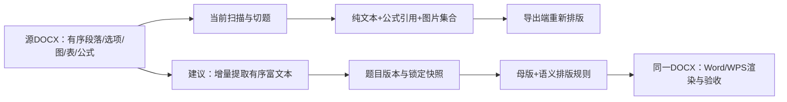

# DOCX对比分析与实现路线

2026-10-10 · 两名研究员独立调查，架构师结合当前代码提出方案 · 本轮不实施

**有可行路径将本系统导出提升到参考样本的图文组织水平，但需要先修内容边界和图文结构，并通过同内容实测。** 单纯把正文调小、段距收紧，或者更换导出库，只能改善外观，不能解决答案片段被当题目、学生版混入答案图、选项图失去位置这些问题。

参考样本的优势并非“用了更高级的公式格式”：它主要使用旧MathType OLE；本项目既有的原生OMML路线仍应保留。公开资料也没有披露组卷网究竟用什么语言、Aspose、POI或哪种分页器，不能据成品文件反推为确定事实。

## 1. 对比范围与证据

用户指定的系统文件为[未命名试卷_学生版_053d517a.docx](<D:/Open-source project/Localtopic-management/outputs/export/未命名试卷_学生版_053d517a.docx>)；参考为[2026年9月17日初中物理作业.docx](<C:/Users/SOAP/Downloads/2026年9月17日初中物理作业.docx>)。

研究员完整审计两文件ZIP/XML，在独立Word16.0实例中只读打开并重新导PDF，渲染全部27页，再追查系统23条锁定快照和相关源DOCX/既有预处理JSON。输入SHA前后不变。原始证据和限制见[本地研究交接](<D:/Open-source project/Localtopic-management/outputs/handoff/R-DOCX导出实测对比.md>)、[公开资料交接](<D:/Open-source project/Localtopic-management/outputs/handoff/R-组卷网公开资料与技术路线.md>)。

两份卷子内容不同：系统23个编号、7页，含不同章节题和答案片段；参考30道光学题，题卷10页、答案解析10页。因此**不能用7页对20页、文件大小或图片总数评质量**。下面比较的是版式组织、内容结构及可复现的问题，页码仅适用于本轮Word环境。

## 2. 具体差异

|项目|系统样本实测|参考样本实测|意味着什么|
|---|---|---|---|
|内容完整性|第5–12号共8条是答案片段，例如“C”“A”“正/不显”；对应7个独立qid|30道题卷，后附独立答案与详解|本系统首先有切题/入库边界问题，不能算成排版问题|
|学生版答案隔离|第23题/qid7942出现已接好线的答案图|答案图放在后面的答案区|图片也要随答案模式过滤，不能只切文字|
|纸张/页边距|A4竖向单栏，上下左右20mm|A4竖向单栏，上下17mm、左右20mm|参考上下合计多6mm正文空间；本样本不是双栏|
|正文字体|中文和西文均宋体12pt|中文宋体10.5pt，西文Times New Roman10.5pt|参考更紧凑，中西文字体有分工|
|标题/卷头|黑体16pt粗体；“未命名试卷”；班级/姓名|宋体15pt非粗体；明确日期学科作业名；学校/姓名/班级/考号|模板与用户是否填标题都会影响成品观感|
|行距|主要1.5倍|主要同为1.5倍|差距不能归结为“系统1.5倍、参考单倍”|
|段落留白|统一题末16pt；图前10pt、图后10或16pt|正文多为连续段，通常没有额外题末16pt|系统统一留白偏大，应按题型/图用途配置|
|大题组织|唯一有效标题“未分组”；题13/22末残留源“四、实验题”“三、综合题”|六大题按单选、填空、作图、实验、阅读组织|源标题应与题干分开，当前卷大题需要真正建立|
|题号/重复题|1–23连续，无双重源题号；qid64、qid12各被清单选入两次|题卷1–30，答案区同号对应；题号也是普通文本|重复选题来自清单，不能归咎编号算法；自动编号不是美观前提|
|选项排布|TAB被转换成4空格；第15题选项“分子”被挤到下一行|保留60个TAB；可见一行4项、两行2项、四行1项|需要选项对象、制表位/列宽与宽度回退|
|图文位置|11个普通图全部作为独立居中段放在题文字后|46个普通inline实例引用41个文件；图可位于题干和选项间、A/B同段、小问后|图片需要出现实例及所属位置，不能只是文件集合|
|选项图尺寸|第2题4图宽约6.72–6.985cm，纵排并跨页；源宽仅约254–264px|第6题图选项宽3.36–4.075cm，第15题小选项图宽0.873–1.773cm|应按用途定大小；不是每幅小图都该占正文一半|
|清晰度例子|第1题190×202px图显示约5.03×5.35cm，约96dpi|第3题组合图1756×359px显示约17×3.46cm，约262dpi|这两个实例说明源像素和印刷尺寸重要，不能推成参考所有图都更清晰|
|表格|样本0表，本身未选入表格题|实验表4×3；单选答案汇总表4×11|长期需要真正的表格模型，不能用空格/截图代替|
|公式结构|0 OMML、0 OLE；题干公式引用0；快照7个占位符均在排除的解析中|24个MathType OLE+1原生OMML；3 OLE在题卷，其余21在答案|本系统样本无公式是内容与模式所致，不能说转换失败；也不能凭该文件证明OMML可编辑|
|页脚/答案|整卷PAGE+NUMPAGES；学生版不应有答案|题卷/答案分节，各自PAGE+SECTIONPAGES并重置1–10|学生版没有正常答案区是模式选择，不是缺陷；可增加独立答案出版形态|
|分页|58处keepLines启用、36处keepNext启用，试图整题保护；超长题仍被Word拆开|正文没有keepNext/keepLines，4行表格cantSplit|两者都有需要改进处，不能全部照抄参考或无限整题绑定|

普通图、OLE预览必须分开计数：参考61个媒体文件=41普通图+19个不同公式预览+1二维码；46普通图是出现实例数。另一个浮动二维码用VML，虽然DrawingML anchor为0，仍不能说完全没有浮动图。两份文件都没有`w:vertAlign`，参考指数由OLE/OMML呈现；线性文本`3×108`不能当作指数实际丢失。

## 3. 最需要先修的两个正确性问题

**学生版泄漏答案图。** [系统第7页](<D:/Open-source project/Localtopic-management/outputs/docx-compare-20261010/local/system-page-7.png>)第23题上图是未接线题干，下图是已经完成的接线答案。回源到解析版DOCX：题干图image123在body p353，答案图image124在p359的`【答案】(1)`段。输出image11与答案image124的SHA完全一致，见[source-trace.json](<D:/Open-source project/Localtopic-management/outputs/docx-compare-20261010/local/source-trace.json>)。这是本轮实证的一题一图，不代表已经统计全库影响规模。

原因是当前`bank/export.py:673`只分离题干与答案文字，但`:1229–1234`仍把整题图片列表全部输出。更早的`pipeline/segment.py:195`已经将题范围里的图片汇总成无分支文件列表，`bank/paper.py:443`锁定的也是路径/hash。正确修法是保留stem/answer/analysis所属关系。归属不明必须核对，不能删掉所有未知图来获得“学生版无答案”的表面结果。

**答案区记录被当成题目。** [系统第4页](<D:/Open-source project/Localtopic-management/outputs/docx-compare-20261010/local/system-page-4.png>)可以看到6.A、7.B、8.正/不显等，5.C在第3页。qid5542的原源“参考答案”位于scan index125，1.C位于171；既有切题结果仍将171–176入库为题。qid61也在原参考答案标题后被独立入库。学生版过滤详解后剩一个答案字母，**导出器没有从一个完整题干里删掉主体**。

这要求导入识别整卷答案区域，再用可信内容对应原题；不能盲改答案分离正则，不能按题号相同强配，更不能把所有短文本都当坏题。已选入的历史卷应提示并显式修订，不能悄悄替换清单或重写锁定快照。

## 4. 为什么会出现这些差异

当前系统的主路径是“文本+公式占位符+图片文件集合”。公式位置部分保留，图片出现位置、原显示尺寸、选项归属、表格结构、run字体语义和答案图片分支大多没有进入题目版本及组卷快照。到了导出端，这些信息无法从一个字符串可靠猜回来。

具体触点：`pipeline/docx_scan.py:181`图片按资源路径去重记录，`:270–274`表格展平成格内段；`pipeline/segment.py:191–199`拼文本和图片集合；`bank/importer.py:227–230`存图路径/hash；`bank/export.py:499–522`去空行、TAB变空格；`:1226–1252`按“题文字→全部图→答案→解析”固定顺序渲染并全题链keep。仅换一个库，依然会渲染同样缺信息的模型。

应保留现有优势：题目内容已随组卷快照锁定；原生OMML交付方向合理；像素预览和最终下载已经复用同一份缓存DOCX（`webui/services/export_svc.py:167–174`）。需要区别的是浏览器结构预览：它按整题DOM块分页，固定纸高并隐藏溢出，长题可能裁切；它与Office真实分页的差异不能靠一个固定行高系数完全消除。

## 5. 能核实的组卷网信息，与不能核实的部分

[学科网官方历史介绍PDF](https://zxxkstatic.zxxk.com/service/file/%E5%AD%A6%E7%A7%91%E7%BD%91%E8%B5%84%E6%BA%90%E5%86%85%E5%AE%B9%E4%BB%8B%E7%BB%8D.pdf)第10页披露资源校审、分类打标、内容优化及CMS主数据流程。这支持“成品质量依赖内容加工和复核”的判断；它含2020年历史统计，不能拿来描述当前运营规模，更不说明DOCX底层生成实现。

本轮官方首页/帮助/产品手册读取受限，未能充分核实当前下载弹窗的全部设置。纸型枚举、单双栏、公式格式可选项等不能借其他同名组卷产品的教程补成学科网事实。完整链接与读取边界见[来源记录](<D:/Open-source project/Localtopic-management/outputs/docx-compare-20261010/public/sources.md>)。

以下仅是**本项目可实施路线**：WordprocessingML可表示段落/run/表格；OMML是Office文档数学格式；图片可以随文本inline或另有浮动行为；分页需目标排版器重排。这些分别有[Microsoft数学格式说明](https://learn.microsoft.com/en-us/office/math/)、[python-docx文本API](https://python-docx.readthedocs.io/en/latest/api/text.html)和[图片能力说明](https://python-docx.readthedocs.io/en/latest/user/shapes.html)支撑。它们不证明组卷网使用这些库。

## 6. 建议实施顺序

|阶段|交付目标|主要触点|通过后才能做什么|
|---|---|---|---|
|P0：正确性与最小隔离探针|确认题干完整、清单重复、源标题；按分支隔离答案图；同内容新导出反证；少量完整题试模板与选项布局|segment/answers、paper快照、export文档计划、组卷提示与副本验证|能证明样本关键问题被修正，不能宣称全库或所有版式达标|
|P1：结构与出版模型|有序富文本、选项/子问、图实例锚点、表格、独立答案树；快照/模板版本化；合法长题续页；结构预览完整可读|docx_scan/segment/importer/db/edit/paper/export，前端livePreview，preview缓存指纹|这是普遍达到参考样本图文组织能力的主要路径|
|P2：引擎与扩展|评估直接OOXML/独立组装服务；有需要再评估商业分页引擎；更多母版/答案册模式|独立渲染适配器及PoC，保留旧路径|只有同内容兼容/性能实测支持时才替换，不先迁语言或采购|

**最小样式路径**可从参考本文件复制参数：A4竖单栏，上下17mm/左右20mm，中文宋体10.5pt/西文Times New Roman10.5pt，标题宋体15pt，行距1.5；题末间距按题型缩小。选项短文本用制表位，图/多行用无边框表格，按实际宽度在4列→2列→1列回退，允许教师覆盖。题号由一个输出层负责，原题号保留来源字段，小问号/小数/分值不误删。样式参数可以先做，恢复图位置需要结构支持。

**长期结构路径**应保存独立stem/options/subquestions/answer/analysis树，节点含段落、表格、图片与作答区，行内保存文字run和公式/图引用。资源hash与出现实例分开，图实例保存用途、位置、尺寸、源part/XPath/scan锚点；同一图复用三次仍是三次。原OLE/预览保留作来源，对已复核公式继续输出OMML；不能把图像公式称为可编辑公式。保真源片段不能覆盖数据库已修正的公式，也不能混入不属于学生版的答案分支。

**分页路径**保留短题保护、大题标题与首段同页、图与直接说明同页；长题按段落/小问/表格行续排，题号分值只在首片段出现。参考本身存在第6/12/15题图文跨页、9题选项跨页、第25题作图指令与图分页，答案最后p20仅两行；不应照搬。浏览器用于结构操作并保证完整可读，定稿用同一DOCX的Office像素预览。Word/WPS分别校准和记录差异；[Word官方重新分页接口](https://learn.microsoft.com/en-us/office/vba/api/word.document.repaginate)不能保证跨客户端像素完全相同。

**工具选择**先保留现有Python业务与Word/WPS链路，对bridge不足处用受控OOXML增强或`python-docx + XML`隔离探针。python-docx高级API主要支持inline图片，也不带分页器；换库不是万能保真。Aspose有[自有布局引擎](https://docs.aspose.com/words/python-net/rendering/)，可作为将来服务器渲染候选，但须对中文字体、图表、复杂公式、双端编辑做同内容PoC；本轮没有证据说组卷网使用Aspose。

## 7. 版本与验收不能省略

新富文本必须跟随题目版本与组卷快照锁定。旧卷保持旧reader/renderer，用户明确升级才生成新快照；不能在导出时回源读取最新版去覆盖历史内容。源缺失/SHA不同或锚点无法确定时保留待核对，不猜位置。现有preprocess_final不得重生成；先用独立目录增量补提取、人工核对，再讨论正式迁移。

迁移前备份并按`verify_backup(original, backup)`验证，所有写入试验用副本；新增能力保持幂等和失败回滚，旧版作为可选退路，但已知答案泄漏/内容缺失不能靠退回旧版当作通过。模板revision、富文本/媒体布局digest和渲染环境需进入缓存与预览门禁指纹，防止模板改了仍下载旧缓存。

建议验收的硬指标：

1. 同内容、同答案模式、同模板的新旧导出；先实测旧路径确有问题，再测候选。逐item文本/选项/小问/表格/图实例清单覆盖100%，无丢失/误重复，学生版答案节点及答案专属媒体引用为0。
2. q7942学生版保留image123且不含答案image124；答案版保留image124并位于答案分支。5–12答案片段正确标识与阻断，合法短题反例不误伤。重复清单和连续编号分别验收。
3. 每item顶层题号只出现一次，1..N连续；小问/单位/小数不变；分值/大题subtotal与副本SQL一致。图片比例误差≤1%，源尺寸保真模式extent误差≤1mm（拟议阈值）；页边距/字号/样式与选定母版一致，无裁切、非预期空白页或孤立图标签。
4. 另备含分式/根式/上下标/中文/单位/私有字形/高行内公式的代表卷。每个实际公式在Word/WPS分别内部改字符→保存→重开→比对，覆盖100%。仅节点存在、能打印、能拖动图片不算公式可编辑。
5. 同一待交付DOCX在Word/WPS分别重新分页、导PDF并渲染逐页看；记录每页题号和图锚点，长题合法续页，浏览器完整可读。保留像素预览与下载同源hash校验；旧快照逐字段不变，修改后完整回归与前端tsc/build。T/V从源独立造反例。

详细节点边界、兼容退路、代码触点及验收样本见[A架构交接](<D:/Open-source project/Localtopic-management/outputs/handoff/A-达到组卷网导出效果方案.md>)。

## 8. 证据快速入口与本轮边界

|证据|查看重点|
|---|---|
|[系统第2页](<D:/Open-source project/Localtopic-management/outputs/docx-compare-20261010/local/system-page-2.png>)、[第3页](<D:/Open-source project/Localtopic-management/outputs/docx-compare-20261010/local/system-page-3.png>)|第2题四图纵排跨页；5.C答案片段|
|[系统第4页](<D:/Open-source project/Localtopic-management/outputs/docx-compare-20261010/local/system-page-4.png>)、[第5页](<D:/Open-source project/Localtopic-management/outputs/docx-compare-20261010/local/system-page-5.png>)|答案片段、源大题标题残留、选项断行|
|[系统第7页](<D:/Open-source project/Localtopic-management/outputs/docx-compare-20261010/local/system-page-7.png>)|未接线题图与已接线答案图同时出现|
|[参考第2页](<D:/Open-source project/Localtopic-management/outputs/docx-compare-20261010/local/reference-page-02.png>)、[第9页](<D:/Open-source project/Localtopic-management/outputs/docx-compare-20261010/local/reference-page-09.png>)|选项图与标签同段、实验表|
|[参考第11页](<D:/Open-source project/Localtopic-management/outputs/docx-compare-20261010/local/reference-page-11.png>)、[第15页](<D:/Open-source project/Localtopic-management/outputs/docx-compare-20261010/local/reference-page-15.png>)|独立答案区与汇总表、数学指数实际显示|
|[系统PDF](<D:/Open-source project/Localtopic-management/outputs/docx-compare-20261010/local/system.pdf>)、[参考PDF](<D:/Open-source project/Localtopic-management/outputs/docx-compare-20261010/local/reference.pdf>)|本轮只读Word重渲染，可逐页检查|

本轮未改实现、API、schema、输入文件或交付库，未新导出修复产物，未进行公式内部编辑保存测试，也未用WPS复渲这两份样本。新路线尚未开发和验收；样本实测结论不扩大为组卷网全部模板或本系统全库统计。A阶段末全量回归318项，317通过、1 skip，29.317秒，见[测试日志](<D:/Open-source project/Localtopic-management/outputs/docx-compare-20261010/A-closure-tests.log>)；19项源码/库/输入文件hash与长度全部不变，见[前守护](<D:/Open-source project/Localtopic-management/outputs/docx-compare-20261010/A-readonly-guard-before.json>)、[后守护](<D:/Open-source project/Localtopic-management/outputs/docx-compare-20261010/A-readonly-guard-after.json>)。库SHA256仍为`6905955734953c6cdffa4c65b1dd6950bb575dd1fb0e68dbd4b013ae8e6602c6`；回归通过仅说明研究阶段保持基线。

**G1：本轮仅分析方案，无契约变更。后续实施须先明确授权相关冻结文件，再冻结富文本/导出/缓存新增契约，由开发和独立测试推进；本报告不代表已批准开发。**
