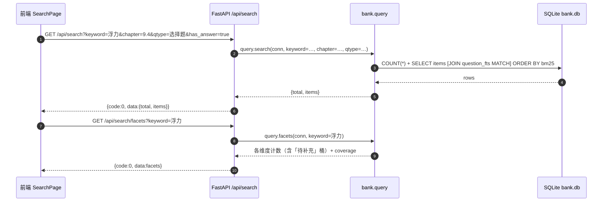
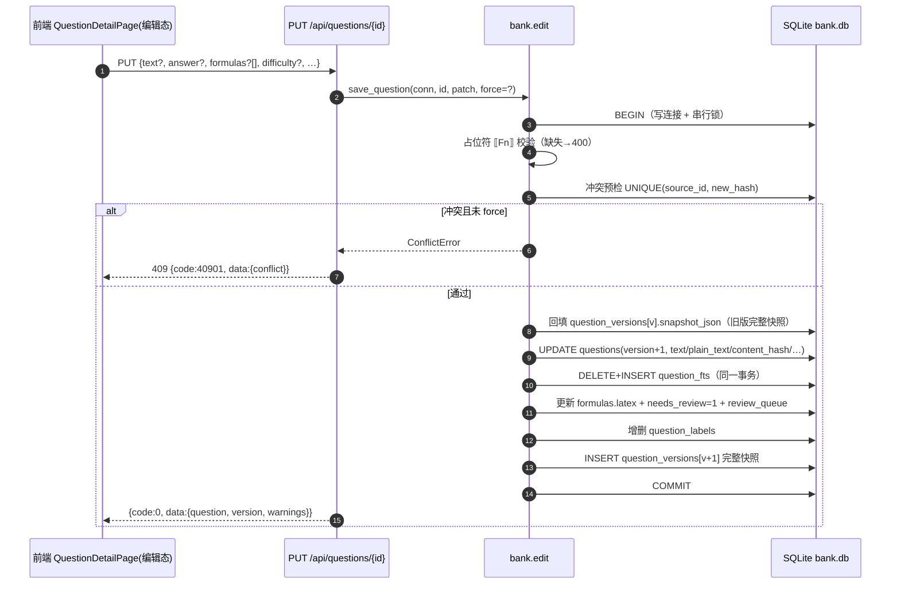
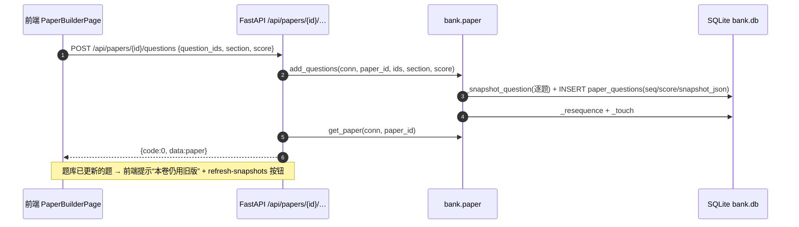
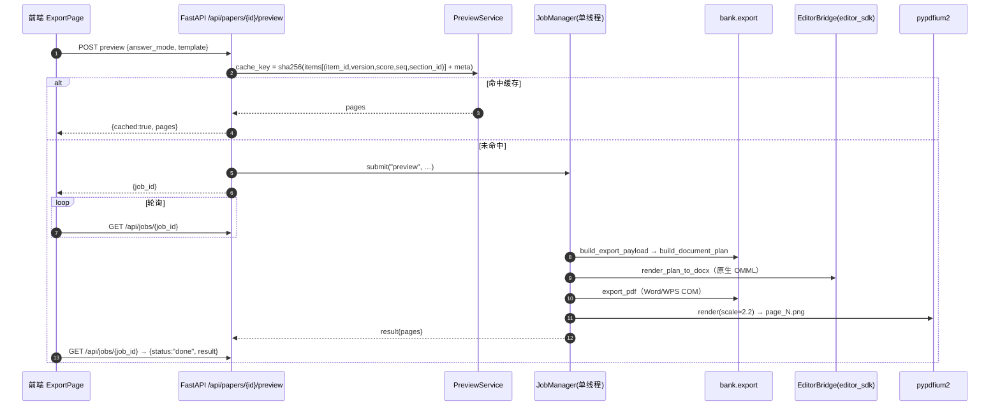
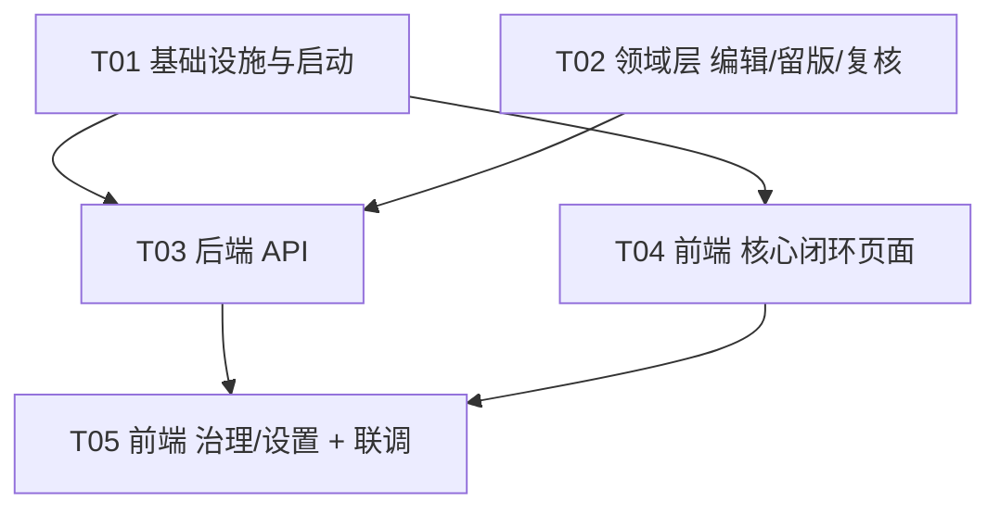

# 系统架构设计 —— 题库 Web 界面（初中物理 · 本地单机版）

> 版本：v1.0 ｜ 作者：高见远（架构师）｜ 日期：2026-10-07
> 上游依据：`outputs/webui/PRD-题库Web界面.md`（Alice）、`bank/README.md`、`bank/*.py` 源码、`outputs/单人本地生产级达标报告.md`、`tests/`（216 项）
> 本文件所有表结构 / 接口 / 性能数字均**逐行核对源码与报告**，未编造。
> 2026-10-09 实现补充：当前为 **48 个 API 端点**，新增 `GET /api/review/{rq_id}/preview`；复核列表含题干/当前公式，检索列表含 `needs_review`，export-data 图片含 `id/url/width/height`。门禁额外绑定请求版本和答案模式/模板；本轮结果与限制见 `../续作验证报告-20261009.md`，下文 v1 设计数量保留历史记录。

---

## 0. 设计总则（先读）

1. **复用而非重写**：Web 层只做「HTTP 契约 + 参数校验 + 事务编排」，一切业务逻辑调用 `bank/` 既有函数（`query.search` / `paper.*` / `export.*` / `labels.*` / `answers.*` / `enrich.*`）。新增的领域逻辑（编辑/留版/复核）放在 **`bank/` 内的新模块**，不放 API 层。
2. **不破坏 216 项测试**：所有对既有模块的改动都是**纯新增**（新增函数 / 新增可空列 / 新增文件）。既有函数签名与返回值**不改**。
3. **只读路径不改库**：导出/预览走 `bank.db.connect_readonly`，沿用既有「导出不改 bank.db」保证。
4. **写路径串行 + 事务**：所有写操作经单一写连接 + 应用级写锁，单事务提交；编辑前先做旧版快照，保证可回溯。
5. **单机形态**：无账号/登录/权限；仅处理「本机多标签页/多窗口」的并发。

---

# Part A：系统设计

## 1. 实现方案与选型

### 1.1 核心难点与对策（先摆问题，再给选型）

| 难点 | 本质 | 本设计对策 |
|---|---|---|
| 在线编辑「留版」 | 现有 `question_versions` 只存题干文本，**不含公式/答案/解析/元数据**，与「编辑公式也留旧版」冲突 | 新增 `question_versions.snapshot_json`（**完整快照**，格式对齐 `paper_questions.snapshot_json`），编辑前回填旧版快照；幂等迁移 |
| `⟦Fn⟧` 占位符与公式编辑联动 | 题干是占位符、公式在 `formulas` 表按 `fid` 关联 | 保存前校验「题干中所有 `⟦Fn⟧` 都有对应公式行」；公式 latex 单独写回；改动公式后重新入队待复核 |
| `content_hash` 唯一约束冲突 | 改文本后可能与同来源另一题撞 `UNIQUE(source_id, content_hash)` | 保存前**事务内预检**；默认返回 **409 显式冲突**（非静默、非崩溃），并提供 `force` 明确确认路径 |
| 像素级预览成本 | 每次预览 = 生成 DOCX(≈3–4.6s) → 导出 PDF → 渲染 PNG | **内容指纹缓存** + **单线程作业队列**（异步 + 轮询），同内容零重渲染 |
| 编辑后检索一致性 | 改题干会变 `plain_text` 与 FTS 索引 | 与 `questions` 更新**同一事务**内 `DELETE + INSERT question_fts`，提交即生效、无脏索引 |
| 并发写（多标签页） | SQLite 写锁（`journal_mode=delete`）会 `SQLITE_BUSY` | 应用级**单写者锁** + `busy_timeout=5000`；WAL 作为可选开关（附读只读导出的注意事项） |

### 1.2 后端选型：FastAPI + Uvicorn（复用现有 `bank/`）

- **框架**：FastAPI（用户已确认引入）。**已实测当前 `kb` 环境可用**：`fastapi 0.125.0` + `pydantic 1.10.26` + `uvicorn 0.54.0`（本机 `C:/Users/SOAP/.workbuddy-ai/binaries/python/envs/kb/Scripts/python.exe`，Python 3.13.14）。已实测「POST + pydantic 模型 → 200 / 非法入参 → 422」正常工作。
- **ASGI 服务器**：`uvicorn`（单进程、单 worker；单机无需多进程，且写操作要串行）。
- **静态托管**：前端 `npm run build` 产物由 FastAPI `StaticFiles` 挂载在 `/`（生产：浏览器只访问一个端口）。
- **依赖注入**：`webui.db.get_conn()`（读）/ `get_write_conn()`（写）作为 FastAPI 依赖，**每请求一个连接**（SQLite 连接不跨线程共享）。
- **长任务**：`webui.jobs.JobManager`（`queue.Queue` + 1 个后台线程），串行执行预览/导出（同时天然保护 `editor_sdk` 单实例与 Word COM）。

> **为什么不用 stdlib `http.server`**：9 个页面 + 文件上传（CSV 导入）+ 长任务 + 静态托管，手写路由/表单解析/并发不划算；FastAPI 已在环境中且是本 PRD 已确认选型。

### 1.3 前端选型：Vite + React + TypeScript + MUI + Tailwind（+ KaTeX）

**判断**：虽然「本地单机」允许更简方案（如 CDN + Preact + 无构建），但本项目有 **9 个页面、双栏实时组卷、在线编辑、拖拽排序、KaTeX 公式、逐条复核**，无构建方案会迅速失控、难维护、难做类型契约。因此**采用构建工具链**，收益（组件化 / 类型安全 / HMR / 与后端 JSON 契约对齐）远超成本。

| 关注点 | 选型 | 理由 |
|---|---|---|
| 构建 | **Vite 5** | 秒级冷启、`build` 产出静态文件供 FastAPI 托管 |
| 框架 | **React 18 + TypeScript** | 生态最全、类型契约与后端 `snake_case` JSON 对齐 |
| 组件库 | **MUI 5** | PRD 指定；表格/对话框/抽屉/Toast 开箱即用 |
| 原子样式 | **Tailwind CSS 3** | PRD 指定；承载设计令牌（`#3370FF`、圆角、间距 8px 栅格） |
| 路由 | **react-router-dom 6** | 9 页面 + 抽屉 |
| 数据请求 | **@tanstack/react-query 5** | 检索/详情/试卷的缓存、失效、轮询（作业状态）一站解决 |
| 轻状态 | **zustand 4** | 双栏组卷的本地编辑态（未提交前）与 UI 偏好 |
| 拖拽 | **@dnd-kit/core + sortable** | 结果卡拖入右栏、右栏排序（P0-7 / P1-10） |
| 公式渲染 | **katex 0.16**（自写 `KatexFormula` 组件，`katex.renderToString`） | 不引入已停止维护的 `react-katex`；用 `throwOnError:false` 降级为红色源码 |
| 主题 | MUI `ThemeProvider` + Tailwind `theme.extend` | 令牌单一来源：`webui/... → 设计令牌常量`，前后端共享「徽章语义色」定义 |

### 1.4 公式渲染（KaTeX）方案

- **展示态**：后端 `GET /api/questions/{id}` 返回 `formulas[]`（含 `fid` 与 `latex`）与 `text`（含 `⟦Fn⟧`）。前端把 `text` 按 `⟦(F\d+)⟧` 切分，占位符处用 `KatexFormula(latex=formulas[fid].latex)` 就地渲染。**按 `fid` 精确映射，非出现顺序**（与 `bank/export.py` 一致，避免串位）。
- **编辑态**（PRD 3.4 方案 A「源码 + 实时预览」）：点公式 → 浮层：左 LaTeX 源码框（预填 `formulas.latex`），右 KaTeX 实时预览。渲染失败（`throwOnError:true` 探针）→ **阻止保存并高亮**，不静默写入。
- **图片**：`GET /api/questions/{id}/media/{image_id}` 从源 DOCX 包内按 `sha256` 取出（复用 `bank.export.resolve_media` 逻辑），**只读**。

### 1.5 像素级预览链路（DOCX → 图片）

```
bank.paper.build_export_payload(conn, paper_id, answer_mode)   # 基于组卷快照
        │
        ▼
bank.export.build_document_plan(payload, template, media_resolver)  # 纯数据“文档计划”
        │
        ▼
bank.export.EditorBridge → render_plan_to_docx()   # 原生 OMML 公式，editor_sdk 直连
        │
        ▼
bank.export.postprocess_bridge_docx()             # 补 graphicData uri + 还原符号实体
        │
        ▼
bank.export.export_pdf(docx)                      # win32com：Word 优先、回退 WPS
        │
        ▼
pypdfium2.PdfDocument(pdf).render(scale≈2.2) → page_N.png   # 逐页位图
        │
        ▼
outputs/webui/preview_cache/<cache_key>/{page_1.png, …, meta.json}
```

**为什么这条链路 = 像素级**：预览与最终导出**走同一份 `plan` 与同一个 DOCX 渲染器**，预览只是把「同一份 DOCX」再导出为 PDF 并位图化——因此版式与导出**逐像素一致**（这是用户确认的「像素级」保真度要求）。

**缓存策略（关键）**：
- `cache_key = sha256( paper.meta(标题/模板/answer_mode/年级…) + ordered[ (item_id, question_version, score, seq, section_id) ] )`。
- 由于 `paper_questions.snapshot_json` 已**锁定内容**，只要上述指纹不变，渲染结果必然不变 → 直接命中缓存、**零重渲染**。
- 任何「加题/删题/重排/设分/改大题/改模板/改答案模式/refresh-snapshots（question_version 变）」都会改变指纹 → 自动失效。
- 缓存目录 `outputs/webui/preview_cache/`；提供 `GET /api/preview/{key}/page_{n}.png` 端点（做路径白名单校验，不用 StaticFiles 直挂缓存目录）。
- 预览与导出**共享同一份渲染产物**：导出时若缓存命中，直接复制/复用 DOCX，不再重跑渲染。

### 1.6 一键启动（老师不会敲命令）

- 入口脚本 **`启动题库.bat`**（双击）：调用 `python -m webui`（`webui/__main__.py`）。
- `webui/__main__.py` 逻辑：
  1. 选定 `kb` 解释器（`sys.executable`，或读 `BANK_PY` 环境变量 / 已知路径）；
  2. 校验/迁移 DB（`ensure_version_snapshot_columns` 等幂等迁移），不存在则提示 `bank.cli init`；
  3. 若 `webui/static/index.html` 不存在 → 提示「先执行 npm run build」（首次由工程师完成，**不要求老师装 Node**）；
  4. `uvicorn.run(app, host="127.0.0.1", port=8720)`；
  5. 后台线程延时 1.5s 后 `webbrowser.open("http://127.0.0.1:8720")`；
  6. 控制台打印「题库已启动，关闭此窗口即退出」。
- **只监听 `127.0.0.1`**（不暴露到局域网，符合「纯本地单机、不涉公网」）。

---

## 2. 文件列表（新增 / 修改）

> 约定：`bank/` 为既有领域包；`webui/` 为新增后端；`frontend/` 为新增前端；`outputs/webui/` 为文档与运行时产物。

### 2.1 后端（Python，新增）

| 相对路径 | 职责（一句话） |
|---|---|
| `webui/__init__.py` | 包标识与版本 |
| `webui/config.py` | 配置读写（DB 路径、导出目录、默认模板、KaTeX/主题偏好），持久化到 `outputs/webui/settings.json` |
| `webui/db.py` | 连接工厂：读连接 / 写连接；`busy_timeout=5000`；应用级写锁；可选 WAL 开关 |
| `webui/errors.py` | 统一错误类型（`ApiError`/`NotFound`/`Conflict`/`Validation`）与异常处理器，产出 `{code,data,message}` |
| `webui/schemas.py` | Pydantic 请求/响应模型（搜索、编辑、试卷、复核、设置…） |
| `webui/jobs.py` | `JobManager`：单后台线程 + `queue.Queue`，串行执行预览/导出，`submit/get` |
| `webui/app.py` | FastAPI 应用工厂：挂载路由、异常处理器、静态资源、`/api/health` |
| `webui/__main__.py` | 一键启动器（选解释器、迁移、起 uvicorn、开浏览器） |
| `webui/requirements.txt` | 后端依赖声明（含版本下限） |
| `webui/services/__init__.py` | 服务包标识 |
| `webui/services/search.py` | 检索与筛选栏（调用 `query.search` / `query.facets`） |
| `webui/services/questions.py` | 单题详情、编辑保存、版本历史、媒体（调用 `bank.edit` / `query.get_question`） |
| `webui/services/papers.py` | 试卷 CRUD、组卷操作、快照刷新（调用 `bank.paper`） |
| `webui/services/export_svc.py` | 预览/导出作业的编排（调用 `bank.export` + `preview`） |
| `webui/services/preview.py` | 像素级预览渲染 + 缓存（DOCX→PDF→PNG，`pypdfium2`） |
| `webui/services/labels_svc.py` | 知识点复核（调用 `bank.labels`） |
| `webui/services/review_svc.py` | 待复核公式队列（调用 `bank.query.list_review` / `bank.review`） |
| `webui/services/sources_svc.py` | 来源文件管理（调用 `query.list_sources` / `source_detail`） |
| `webui/services/stats_svc.py` | 题库统计（调用 `query.stats` + `answers.coverage` + `enrich.coverage` + `labels.status_counts`） |
| `webui/services/settings_svc.py` | 系统设置读写（`webui/config`） |
| `webui/routers/__init__.py` | 路由聚合 |
| `webui/routers/search.py` | `/api/search*` |
| `webui/routers/questions.py` | `/api/questions*` |
| `webui/routers/papers.py` | `/api/papers*` |
| `webui/routers/export.py` | `/api/papers/{id}/preview`、`/export`、`/api/jobs/*`、`/api/preview/*` |
| `webui/routers/labels.py` | `/api/labels/*` |
| `webui/routers/review.py` | `/api/review*` |
| `webui/routers/sources.py` | `/api/sources*` |
| `webui/routers/stats.py` | `/api/stats`、`/api/meta/coverage` |
| `webui/routers/settings.py` | `/api/settings` |
| `启动题库.bat` | 双击一键启动（`python -m webui`） |

### 2.2 领域层（`bank/`，新增模块 + 既有模块的**纯新增**改动）

| 相对路径 | 职责 |
|---|---|
| `bank/edit.py`（**新增**） | 编辑领域逻辑：`ensure_version_snapshot_columns`、`save_question`（留版+重算+FTS+冲突处理）、`update_file_metadata`（文件级年级/教材）、`set_difficulty`/`batch_set_difficulty`、`list_versions`/`get_version` |
| `bank/review.py`（**新增**） | 待复核公式队列：`resolve`（标记已处理）、`summary`（按状态计数） |
| `bank/query.py`（**修改，仅新增函数**） | 新增 `facets`（筛选栏计数 + 待补充桶 + 覆盖率）、`coverage_summary`、`source_detail`；**不改既有函数** |
| `bank/labels.py`（**修改，仅新增函数**） | 新增 `review_items`（按标签列逐条关联）、`preview_decision`（批量决策影响条数预检）；**不改既有函数** |

> **不改**：`bank/db.py`（DDL 不动，版本快照列由 `bank/edit.py` 幂等迁移，风格对齐 `answers.ensure_answer_columns`）、`bank/importer.py`、`bank/paper.py`、`bank/export.py`、`bank/cli.py`、`bank/answers.py`、`bank/enrich.py`。

### 2.3 前端（`frontend/`，新增）

| 相对路径 | 职责 |
|---|---|
| `frontend/package.json` | 依赖与脚本（`dev`/`build`/`preview`） |
| `frontend/vite.config.ts` | Vite 配置；dev 代理 `/api → http://127.0.0.1:8720`；build 输出到 `../webui/static` |
| `frontend/tsconfig.json` / `tsconfig.node.json` | TS 配置 |
| `frontend/tailwind.config.js` / `postcss.config.js` | Tailwind + 设计令牌 |
| `frontend/index.html` | SPA 挂载点 |
| `frontend/src/main.tsx` | 入口（QueryClient + ThemeProvider + Router） |
| `frontend/src/App.tsx` | 布局（侧边导航 + 主区 + 全局 Toast/Confirm） |
| `frontend/src/theme.ts` | MUI 主题（主色 `#3370FF`、语义色、圆角） |
| `frontend/src/index.css` | Tailwind 指令 + 全局样式 |
| `frontend/src/router.tsx` | 9 页面路由表 |
| `frontend/src/api/client.ts` | fetch 封装：统一解包 `{code,data,message}`、错误 Toast、超时 |
| `frontend/src/api/types.ts` | 与后端对齐的 TS 类型（Question/Paper/Formula/Badge…） |
| `frontend/src/api/{search,questions,papers,export,labels,review,sources,stats,settings}.ts` | 各域 API 调用 |
| `frontend/src/store/{paperStore,uiStore}.ts` | 组卷本地编辑态 / UI 偏好（深色模式、筛选展开） |
| `frontend/src/hooks/{useSearch,useJob}.ts` | 检索分页 hook、作业轮询 hook |
| `frontend/src/components/StatusBadges.tsx` | **统一徽章**：有/无答案、有/无解析、难度（未标注/易/中/难）、待复核、知识点三态 |
| `frontend/src/components/CoverageBanner.tsx` | P0-13 覆盖率提示条（橙色、非阻塞、可关闭） |
| `frontend/src/components/FilterSidebar.tsx` | 左侧固定筛选栏（分组、计数、待补充桶、严格模式开关） |
| `frontend/src/components/QuestionCard.tsx` | 结果卡（题干预览 + 徽章 + 加入/详情 + 拖拽源） |
| `frontend/src/components/KatexFormula.tsx` | KaTeX 渲染组件（含错误降级） |
| `frontend/src/components/FormulaEditor.tsx` | 公式编辑浮层（源码 + 实时预览） |
| `frontend/src/components/QuestionEditor.tsx` | 题目编辑表单（文字/元数据/公式/知识点，文件级字段二次确认） |
| `frontend/src/components/VersionHistory.tsx` | 只读版本历史（时间/字数/摘要 + 展开查看，无回滚按钮） |
| `frontend/src/components/PaperPanel.tsx` | 右栏试卷（大题分区、行内菜单、上/下移、拖拽排序、设分） |
| `frontend/src/components/PreviewViewer.tsx` | A4 分页预览（缩放、翻页、卷头/答案区/无答案标注） |
| `frontend/src/pages/SearchPage.tsx` | P1 检索页 |
| `frontend/src/pages/QuestionDetailPage.tsx` | P2 单题详情 + 编辑态 |
| `frontend/src/pages/PaperBuilderPage.tsx` | P3 双栏组卷（含试卷抽屉） |
| `frontend/src/pages/ExportPage.tsx` | P4 导出预览 + 导出 |
| `frontend/src/pages/KnowledgeReviewPage.tsx` | P5 知识点复核 |
| `frontend/src/pages/FormulaReviewPage.tsx` | P6 待复核公式队列 |
| `frontend/src/pages/SourcesPage.tsx` | P7 来源文件管理 |
| `frontend/src/pages/StatsPage.tsx` | P8 题库统计 |
| `frontend/src/pages/SettingsPage.tsx` | P9 系统设置 |

### 2.4 测试与产物

| 相对路径 | 职责 |
|---|---|
| `tests/test_edit.py`（新增） | 编辑/留版/冲突/FTS/难度 单测 |
| `tests/test_review.py`（新增） | 待复核 resolve/summary + facets 单测 |
| `outputs/webui/架构设计.md` | 本文档 |
| `outputs/webui/sequence-diagram.mermaid` / `class-diagram.mermaid` | 图源 |
| `outputs/webui/settings.json`（运行时生成） | 用户设置 |
| `outputs/webui/preview_cache/**`（运行时生成） | 预览缓存 |

---

## 3. 数据结构与接口契约

### 3.1 数据库变更（**全部为可空新增列 + 幂等迁移，不改既有列/约束**）

**新增列 `question_versions`（由 `bank.edit.ensure_version_snapshot_columns(conn)` 幂等 ALTER）**

```sql
-- 幂等迁移（PRAGMA table_info 判断后 ALTER TABLE ADD COLUMN；重复执行返回 []）
ALTER TABLE question_versions ADD COLUMN snapshot_json TEXT;   -- 完整快照（JSON），格式同 paper_questions.snapshot_json
ALTER TABLE question_versions ADD COLUMN change_source TEXT;   -- import / edit / manual
ALTER TABLE question_versions ADD COLUMN note TEXT;            -- 变更摘要（可选）
```

**`snapshot_json` 结构**（与 `bank/paper.py::_snapshot_question` 对齐，并追加 `labels`）：

```json
{
  "question_id": 3753, "version": 3,
  "number": "7", "label": "编号", "qtype": "选择题", "difficulty": "中",
  "section": "一、选择题", "chapter": "9.4",
  "content_hash": "…", "char_length": 128,
  "text": "…⟦F1⟧…", "plain_text": "……",
  "answer": "B", "analysis": "由阿基米德原理…", "answer_source": "inline",
  "formulas": [{"fid":"F1","seq":1,"kind":"omml","status":"OK","latex":"F=\\rho gV",
                "progid":null,"part":null,"preview":null,"needs_review":0}],
  "images": [{"media_path":"media/image1.png","sha256":"…"}],
  "labels": [{"namespace":"知识点","name":"浮力","review_status":"待复核","source":"dictionary"}],
  "source": {"source_id":12,"file_name":"…docx","stage":"初中","subject":"物理",
             "grade":"八年级下册","textbook":"苏科版","chapter":"9.4",
             "start_paragraph":41,"end_paragraph":44}
}
```

> **为什么用单列 `snapshot_json` 而非多列**：与既有 `paper_questions.snapshot_json` 同构，一套 `_snapshot_question` 逻辑两处复用；避免为每种字段再加列；对既有测试零影响（旧行该列为 `NULL`）。

**其余不变**：`questions`（含 `difficulty`）、`source_files`（含 `grade_source`/`textbook_source`）、`formulas`、`review_queue`（`UNIQUE(formula_id)`）、`question_labels.review_status` 均沿用现状。

**难度档位（Q5 已裁定：易/中/难 三档）**：`bank.edit.DIFFICULTIES = ("易","中","难")`，默认占位 `未标注`；**不做任何自动推断**（保护 `tests/test_enrich.py::TestDifficultyProtected` 约定）。

### 3.2 编辑保存算法（`bank.edit.save_question`，设计难点 1/2/4/5 的落地）

```
输入：conn, question_id, patch{text?, answer?, analysis?, qtype?, chapter?, difficulty?,
                              formulas?[{fid, latex}], labels?[str]}, force=False
1. 读当前题 cur（含 text/version/source_id/content_hash/answer/analysis/difficulty…）+ 当前 formulas + labels
2. 占位符校验：若 patch.text 存在，解析 ⟦(F\d+)⟧ 集合 P；若 P ⊄ {当前 fid ∪ patch.formulas.fid} → 抛 Validation(400)
3. 计算新 text/plain_text/char_length/content_hash（仅当 text 变；用 bank.textutil）
4. 冲突预检：若 text 变，SELECT id FROM questions WHERE source_id=cur.source_id
             AND content_hash=新hash AND id<>question_id
   - 命中 且 not force → 抛 Conflict(409)，data 带 {question_id, number, snippet}；不写库
   - 命中 且 force    → 采用「去重后缀哈希」：content_hash = sha256(normalize(text) + "\x00dup:" + str(question_id))
                        （保证编辑成功且不违反 UNIQUE；副作用见 §9 待明确 M2）
5. BEGIN（写连接 + 全局写锁）
6. 留版：UPDATE question_versions SET snapshot_json=?, change_source=COALESCE(change_source,'import')
         WHERE question_id=? AND version=cur.version AND snapshot_json IS NULL
         —— 用「当前库状态（=旧版内容）」生成完整快照，确保「改了公式后旧版能找回」
7. UPDATE questions SET text/plain_text/char_length/content_hash/answer/analysis/qtype/chapter/
        difficulty/version=cur.version+1/updated_at=now WHERE id=?
8. 同步检索：DELETE FROM question_fts WHERE question_id=?  ; INSERT INTO question_fts(tokens,question_id)
             VALUES (tokenized_text(新text), str(question_id))
9. 公式：对 patch.formulas 每条 UPDATE formulas SET latex=? WHERE question_id=? AND fid=? ；
        置 needs_review=1；review_queue：存在则 UPDATE resolved=0, reason='人工编辑后需复核'，
        不存在则 INSERT（UNIQUE(formula_id) 保证一行）
10. 知识点标签：按 patch.labels 与现状 diff：新增 INSERT question_labels(review_status='待复核')，删除 DELETE
11. 新版本行：INSERT question_versions(question_id, version=v+1, content_hash, text, plain_text,
             char_length, snapshot_json=新完整快照, change_source='edit', created_at=now)
            —— 满足 paper_questions 复合外键 (question_id, version) 的可引用性
12. COMMIT；返回新详情 + {version, warnings:[...]}
```

> **幂等性**：第 6 步仅在 `snapshot_json IS NULL` 时回填；重复保存不重复回填。第 9/10 步以 diff 计算，不产生重复行。
> **不破坏组卷快照**：`paper_questions.snapshot_json` 独立于本题编辑；编辑**不触碰**任何 `paper_questions` 行（沿用既有快照锁定语义）。

### 3.3 文件级元数据编辑（`bank.edit.update_file_metadata`，PRD 3.2 关键约束）

- 年级/教材属于 **`source_files` 文件级**：改一题即改该来源文件下**全部题**。
- 接口语义：`POST /api/sources/{id}/metadata {grade?, textbook?}`；**先调用 `GET /api/sources/{id}/impact?field=grade`** 返回 `affected_questions` 条数，前端二次确认后带 `confirm=true` 才写。
- 写入时同步 `grade_source`/`textbook_source` = `manual`（provenance 留痕）。
- **不改变任何 `content_hash`**（元数据不参与题干哈希），故不触发唯一约束冲突。

### 3.4 API 端点清单

**统一响应**：成功 `{"code":0,"data":<payload>,"message":"ok"}`；失败 `{"code":<非0>,"data":null|{...},"message":"<可读原因>"}`，并设对应 HTTP 状态码。
**统一约定**：JSON 字段全部 `snake_case`（与 `bank` 一致，前端不做转换）；时间 ISO 8601（`%Y-%m-%dT%H:%M:%S`）。

| # | 方法 | 路径 | 入参 | 出参（data） | 主要错误码 |
|---|---|---|---|---|---|
| 1 | GET | `/api/health` | — | `{ok, db, schema_version}` | — |
| 2 | GET | `/api/meta/coverage` | — | `{grade/textbook/chapter/qtype/difficulty/answer/analysis/knowledge 覆盖率, review_open}` | — |
| 3 | GET | `/api/search` | `keyword,stage,subject,grade,textbook,chapter,qtype,difficulty,section,has_answer,has_analysis,needs_review,kp_confirmed_only,limit,offset` | `{total, items[], limit, offset}` | 422 |
| 4 | GET | `/api/search/facets` | 同 `keyword` 及当前筛选 | `{dimensions:{stage:[…],grade:[…],…,待补充}, coverage}` | 422 |
| 5 | GET | `/api/questions/{id}` | — | 单题详情（题干/公式/图片/标签/答案/解析/来源/版本列表） | 40401 |
| 6 | PUT | `/api/questions/{id}` | `patch{text?,answer?,analysis?,qtype?,chapter?,difficulty?,formulas?[],labels?[]}, force?` | `{question, version, warnings[]}` | 40001 占位符缺失 / 40401 / 40901 冲突 |
| 7 | GET | `/api/questions/{id}/versions` | — | `[{version, content_hash, char_length, change_source, note, created_at}]` | 40401 |
| 8 | GET | `/api/questions/{id}/versions/{version}` | — | 该版本完整快照（只读） | 40401 |
| 9 | GET | `/api/questions/{id}/media/{image_id}` | — | 图片二进制（`image/png`） | 40401 / 40404 图片缺失 |
| 10 | POST | `/api/questions/{id}/difficulty` | `{level:易|中|难}` | `{question}` | 40002 非法档位 / 40401 |
| 11 | POST | `/api/questions/difficulty/batch` | `{ids:[int], level}` | `{updated, missing[]}` | 40002 / 422 |
| 12 | GET | `/api/papers` | `status?,subject?` | `[{paper + item_count/total_score/unscored_count}]` | — |
| 13 | POST | `/api/papers` | `{title,subject?,stage?,grade?,template?,answer_mode?,status?}` | `paper` | 40003 模板/答案模式非法 |
| 14 | GET | `/api/papers/{id}` | — | `{paper, sections[], items[], summary}` | 40402 |
| 15 | PATCH | `/api/papers/{id}` | `{title?,template?,answer_mode?,status?,subject?,stage?,grade?}` | `paper` | 40003 / 40402 |
| 16 | DELETE | `/api/papers/{id}` | `force?` | `{deleted, removed_items}` | 40902 非空需 force / 40402 |
| 17 | POST | `/api/papers/{id}/questions` | `{question_ids[], section?, section_id?, position?, score?, group?}` | `paper`（整卷） | 40004 分值非法 / 40402 / 40403 题不存在 |
| 18 | DELETE | `/api/papers/{id}/questions/{item_id}` | — | `paper` | 40402 |
| 19 | POST | `/api/papers/{id}/questions/{item_id}/move` | `{position}` | `paper` | 40402 |
| 20 | POST | `/api/papers/{id}/questions/{item_id}/score` | `{score: number|null}` | `paper` | 40004 / 40402 |
| 21 | POST | `/api/papers/{id}/scores` | `{mapping:{item_id:score}}` | `{updated, missing[]}` | 40004 / 40402 |
| 22 | POST | `/api/papers/{id}/sections` | `{name, position?, description?}` | `paper` | 40402 |
| 23 | PATCH | `/api/papers/{id}/sections/{sid}` | `{name}` | `paper` | 40402 |
| 24 | POST | `/api/papers/{id}/sections/{sid}/move` | `{position}` | `paper` | 40402 |
| 25 | DELETE | `/api/papers/{id}/sections/{sid}` | `force?` | `{deleted, ungrouped}` | 40902 / 40402 |
| 26 | POST | `/api/papers/{id}/refresh-snapshots` | — | `{refreshed, skipped_version_changed}` | 40402 |
| 27 | GET | `/api/papers/{id}/export-data` | `answer_mode?` | `build_export_payload` 产出 | 40402 |
| 28 | POST | `/api/papers/{id}/preview` | `{answer_mode?, template?}` | `{job_id}` 或（命中缓存）`{cached:true, pages[]}` | 40402 |
| 29 | POST | `/api/papers/{id}/export` | `{answer_mode?, template?, formats:["docx","pdf"], out_dir?}` | `{job_id}` | 40402 / 50001 桥接不可用 |
| 30 | GET | `/api/jobs/{job_id}` | — | `{status:pending|running|done|error, progress?, result?, error?}` | 40405 |
| 31 | GET | `/api/preview/{key}/page_{n}.png` | — | PNG 二进制 | 40405 |
| 32 | GET | `/api/labels/review-summary` | `namespace?,status?,limit?` | `{summary[], counts{待复核,已确认,已否决}}` | 422 |
| 33 | GET | `/api/labels/review-items` | `label_name,status?,limit?,offset?` | `{total, items[{question_id,number,snippet,source,review_status}]}` | 40406 标签不存在 |
| 34 | POST | `/api/labels/decision/preview` | `{label_name,decision,question_id?}` | `{matched, pending, will_update}` | 40406 |
| 35 | POST | `/api/labels/decision` | `{label_name,decision,question_id?,confirm:true,force?}` | `{updated, matched, already_decided}` | 40903 未确认批量 / 40406 |
| 36 | GET | `/api/labels/export-review` | `status?` | CSV 文件下载（`text/csv`） | 422 |
| 37 | POST | `/api/labels/import-review` | multipart `file`（CSV） | `{total, applied, skipped, errors[]}` | 40005 CSV 非法 |
| 38 | GET | `/api/review` | `resolved?,status?,limit?,offset?` | `{total, items[]}` | 422 |
| 39 | GET | `/api/review/summary` | — | `{open, resolved, by_status:{UNSUPPORTED,EMPTY,FAIL}}` | — |
| 40 | POST | `/api/review/{rq_id}/resolve` | `{resolved:true}` | `{rq_id, resolved}` | 40407 |
| 41 | GET | `/api/sources` | `limit?` | `[{id,file_name,stage,grade,subject,textbook,chapter,questions_count,formulas_count}]` | — |
| 42 | GET | `/api/sources/{id}` | — | `{source, questions_count, coverage, question_ids_preview[]}` | 40408 |
| 43 | GET | `/api/sources/{id}/impact` | `field=grade|textbook` | `{field, affected_questions}` | 40408 |
| 44 | POST | `/api/sources/{id}/metadata` | `{grade?,textbook?,confirm:true}` | `{source, affected_questions}` | 40903 未确认 / 40408 |
| 45 | GET | `/api/stats` | — | `query.stats` + `answers.coverage` + `enrich.coverage` + `labels.status_counts` + review 计数 | — |
| 46 | GET | `/api/settings` | — | `{db_path, export_dir, default_template, katex, theme}` | — |
| 47 | PUT | `/api/settings` | `{…}` | 更新后的设置 | 40006 非法设置 |

**错误码约定**（`code` 前 3 位 = HTTP 状态语义，便于前端分类）：

| code | 含义 |
|---|---|
| 0 | 成功 |
| 40001–40006 | 参数/校验错误（400）：占位符缺失 / 非法难度 / 非法模板 / 非法分值 / CSV 非法 / 设置非法 |
| 40401–40408 | 资源不存在（404）：题 / 试卷 / 试卷条目 / 图片 / 作业 / 标签 / 复核项 / 来源文件 |
| 40901–40903 | 冲突（409）：内容哈希重复 / 非空需 force / 批量未确认 |
| 422 | FastAPI 入参结构错误（保留框架默认） |
| 50001 | 后端内部错误（含 editor_sdk 不可达、COM/PDF 失败） |

### 3.5 关键服务签名（示意，非实现）

```python
# bank/edit.py
def ensure_version_snapshot_columns(conn) -> list[str]: ...
def save_question(conn, question_id: int, patch: dict, *, force: bool = False) -> dict: ...
def update_file_metadata(conn, source_id: int, patch: dict, *, confirm: bool = False) -> dict: ...
def set_difficulty(conn, question_id: int, level: str) -> dict: ...
def batch_set_difficulty(conn, ids: list[int], level: str) -> dict: ...
def list_versions(conn, question_id: int) -> list[dict]: ...
def get_version(conn, question_id: int, version: int) -> dict | None: ...
DIFFICULTIES: tuple[str, ...] = ("易", "中", "难")

# bank/review.py
def resolve(conn, rq_id: int, *, resolved: bool = True) -> dict: ...
def summary(conn) -> dict: ...

# bank/query.py（新增）
def facets(conn, *, keyword=None, **filters) -> dict: ...
def coverage_summary(conn) -> dict: ...
def source_detail(conn, source_id: int) -> dict | None: ...

# bank/labels.py（新增）
def review_items(conn, *, label_name, status="待复核", namespace="知识点", limit=50, offset=0) -> dict: ...
def preview_decision(conn, *, label_name, decision, question_id=None, namespace="知识点") -> dict: ...

# webui/services/preview.py
def cache_key(conn, paper_id: int, answer_mode: str, template: str) -> str: ...
def render(conn, paper_id: int, answer_mode: str, template: str, key: str) -> dict: ...

# webui/jobs.py
class JobManager:
    def submit(self, kind: str, fn, **kwargs) -> str: ...
    def get(self, job_id: str) -> dict: ...
```

---

## 4. 程序调用流程（Mermaid 时序图）

> 图源：`outputs/webui/sequence-diagram.mermaid`。以下为四张关键链路。

### 4.1 检索（关键词 + 左侧筛选栏）



### 4.2 编辑保存（留版 / 冲突 / FTS 一致）



### 4.3 组卷（左题库 → 右试卷）



### 4.4 像素级预览 + 导出（异步作业 + 缓存）



---

## 5. Anything UNCLEAR

见 **§9 待明确事项**（需 team-lead / 用户决策的点，不在此拍板）。

---

# Part B：任务分解

## 6. 依赖包列表

### 6.1 Python（`webui/requirements.txt`，均已在 `kb` 环境验证可用）

```
fastapi>=0.125.0          # HTTP 框架（用户已确认引入）
uvicorn[standard]>=0.30   # ASGI 服务器
pydantic>=1.10            # 数据校验（当前环境 1.10.26，FastAPI 0.125 已实测兼容）
python-multipart>=0.0.9   # 文件上传（CSV 导入复核决定）
pypdfium2>=5.0            # PDF → PNG（像素级预览，当前 5.14.0）
pywin32>=306              # DOCX → PDF（Word/WPS COM，当前 312）
pillow>=10                # pypdfium2 to_pil() 依赖（当前 12.3.0）
```

> **不新增**：`bank/` 仍只用标准库；上述仅为 `webui/` 层依赖，不侵入 `bank/`。

### 6.2 Node（`frontend/package.json`）

```
dependencies:
  react@^18.2.0
  react-dom@^18.2.0
  react-router-dom@^6.26.0
  @mui/material@^5.16.0
  @mui/icons-material@^5.16.0
  @emotion/react@^11.11.0
  @emotion/styled@^11.11.0
  @tanstack/react-query@^5.51.0
  zustand@^4.5.0
  @dnd-kit/core@^6.1.0
  @dnd-kit/sortable@^8.0.0
  @dnd-kit/utilities@^3.2.0
  katex@^0.16.11

devDependencies:
  vite@^5.4.0
  @vitejs/plugin-react@^4.3.0
  typescript@^5.5.0
  tailwindcss@^3.4.0
  postcss@^8.4.0
  autoprefixer@^10.4.0
  @types/react@^18.3.0
  @types/react-dom@^18.3.0
```

---

## 7. 任务列表（有序 · 含依赖 · 可独立验收）

> 硬性约束：**共 5 个任务**；每任务 ≥3 个相关文件；T01 为项目基础设施（配置 + 入口 + 依赖声明）。

### T01 项目基础设施与一键启动（P0）

- **源文件**：
  - 后端骨架：`webui/__init__.py`、`webui/config.py`、`webui/db.py`、`webui/errors.py`、`webui/app.py`、`webui/__main__.py`、`webui/requirements.txt`、`启动题库.bat`
  - 前端脚手架：`frontend/package.json`、`frontend/vite.config.ts`、`frontend/tsconfig.json`、`frontend/tsconfig.node.json`、`frontend/tailwind.config.js`、`frontend/postcss.config.js`、`frontend/index.html`、`frontend/src/main.tsx`、`frontend/src/App.tsx`、`frontend/src/theme.ts`、`frontend/src/index.css`、`frontend/src/api/client.ts`、`frontend/src/api/types.ts`、`frontend/src/router.tsx`
- **依赖**：无
- **验收标准**：
  1. `python -m webui` 起服务于 `127.0.0.1:8720`，`GET /api/health` 返回 `{code:0,data:{ok:true,…}}`；
  2. `db.py` 连接工厂设 `foreign_keys=ON` + `busy_timeout=5000`，写连接经全局锁；
  3. `cd frontend && npm i && npm run dev` 打开空壳应用（含侧边导航），`npm run build` 产出到 `webui/static`；
  4. 双击 `启动题库.bat` 能起服务并自动打开浏览器；
  5. `python -m unittest discover -s tests` 仍 **216 项全绿**（本任务未动 `bank/`）。

### T02 领域层：编辑 / 留版 / 复核 / 统计查询（P0）

- **源文件**：`bank/edit.py`（新增）、`bank/review.py`（新增）、`bank/query.py`（仅新增 `facets`/`coverage_summary`/`source_detail`）、`bank/labels.py`（仅新增 `review_items`/`preview_decision`）、`tests/test_edit.py`（新增）、`tests/test_review.py`（新增）
- **依赖**：无（与 T01 并行；只依赖既有 `bank/`）
- **验收标准**：
  1. `ensure_version_snapshot_columns` 幂等（二次调用返回 `[]`），新库/旧库均可迁移；
  2. `save_question`：改文本 → `version+1`、`plain_text`/`content_hash`/`char_length` 重算、`question_fts` 同步（改后可立即检索到新文本，旧词不再命中）；
  3. **留版有效**：改公式后，旧版本 `snapshot_json` 中仍能取回**旧公式 latex / 旧答案 / 旧解析**；
  4. **冲突**：构造同来源重复文本 → 未 `force` 抛 `Conflict`（不写库、不抛裸 `IntegrityError`）；`force=True` 能成功保存；
  5. `set_difficulty`/`batch_set_difficulty` 仅接受 易/中/难，非法档位报错；不产生其他难度值（保护既有难度回归测试）；
  6. `facets` 返回各维度计数 + 「待补充」桶 + 覆盖率；`review.resolve`/`summary` 正确；
  7. **`python -m unittest discover -s tests` ≥ 216 + 新增 全绿**（既有测试零回归）。

### T03 后端 API（服务层 + 路由 + 预览导出引擎 + 作业队列）（P0）

- **源文件**：`webui/schemas.py`、`webui/jobs.py`、`webui/services/*.py`（search/questions/papers/export_svc/preview/labels_svc/review_svc/sources_svc/stats_svc/settings_svc）、`webui/routers/*.py`（search/questions/papers/export/labels/review/sources/stats/settings）、`webui/app.py`（挂载路由与异常处理器）
- **依赖**：T01、T02
- **验收标准**：
  1. §3.4 全部端点可调用，返回统一 `{code,data,message}`；错误走统一异常处理器（无裸 500 traceback）；
  2. 检索/详情/组卷端点与 `bank` 行为一致（结果集、分页、分值校验、快照锁定）；
  3. `POST /api/papers/{id}/preview`：首跑返回 `job_id`，轮询到 `done` 后 `pages` 为可访问的 PNG URL；**再次请求同内容命中缓存**（`cached:true`，不再跑渲染）；
  4. `POST /api/papers/{id}/export` 产出 DOCX（+可选 PDF）到导出目录，报告含 `formulas_written`/`warnings`；
  5. 预览/导出在**单工作线程**串行执行（并发提交不互相踩 `editor_sdk`/COM）；
  6. 导出走 `connect_readonly`，**不改动 `bank.db`**。

### T04 前端：核心闭环页面（检索 / 详情+编辑 / 组卷 / 导出预览）（P0）

- **源文件**：`frontend/src/pages/{SearchPage,QuestionDetailPage,PaperBuilderPage,ExportPage}.tsx`、`frontend/src/components/{FilterSidebar,QuestionCard,StatusBadges,CoverageBanner,KatexFormula,FormulaEditor,QuestionEditor,VersionHistory,PaperPanel,PreviewViewer}.tsx`、`frontend/src/store/{paperStore,uiStore}.ts`、`frontend/src/hooks/{useSearch,useJob}.ts`、`frontend/src/api/{search,questions,papers,export}.ts`
- **依赖**：T01（按 §3.4 冻结契约开发；联调归 T05）
- **验收标准**：
  1. 检索页：关键词 + 左侧固定筛选栏（计数 + 待补充桶 + 严格模式开关）+ 结果卡（徽章 + 加入/详情）；
  2. 详情页：KaTeX 渲染真公式、图片、标签三态、答案/解析、只读版本历史（无回滚按钮）；编辑态可改文字/元数据/公式，公式浮层实时预览，保存前文件级字段二次确认；
  3. 组卷页：左题库右试卷双栏，加入/上移下移/拖拽排序/移除/设分/大题分组，实时题数/总分/未设分/无答案预警；「题库已更新」提示 + 刷新快照按钮；
  4. 导出页：先预览（A4 分页 + 卷头 + 题号重排 + 答案区 + 无答案标注）后导出；作业轮询有加载态；
  5. 组件可独立渲染（含空状态、错误态）。

### T05 前端：治理与设置页面 + 全局状态体系 + 端到端联调（P1）

- **源文件**：`frontend/src/pages/{KnowledgeReviewPage,FormulaReviewPage,SourcesPage,StatsPage,SettingsPage}.tsx`、`frontend/src/api/{labels,review,sources,stats,settings}.ts`、`frontend/src/router.tsx`（接入全部 9 页）、`frontend/src/components/StatusBadges.tsx`（徽章定义收敛为单一来源）、端到端联调与 `启动题库.bat` 收尾
- **依赖**：T03、T04
- **验收标准**：
  1. 9 个页面全部可用，导航一致；
  2. 知识点复核：按标签汇总 + 逐条确认/否决 + CSV 导出/导入；**批量否决先显示影响条数并要求确认**（Q6）；
  3. 待复核公式：按状态分 tab（UNSUPPORTED/EMPTY/FAIL）、预览、标记已处理、跳转修公式；
  4. 来源文件：列表（题量/覆盖/状态）+ 详情 + **文件级年级/教材编辑显示影响题数并二次确认**（PRD 3.2）；
  5. 统计页：总览卡 + 各维度分布 + 答案/公式覆盖率；设置页：DB 路径/导出目录/默认模板/KaTeX/主题；
  6. 端到端走查：一键启动 → 检索 → 组卷 → 预览 → 导出 → 详情编辑 → 复核，全程无阻断错误。

### 任务依赖图



---

## 8. 共享知识（跨文件约定）

**8.1 API 返回结构**
- 成功：`{"code":0,"data":<payload>,"message":"ok"}`；失败：`{"code":<非0>,"data":null|{...},"message":"<可读原因>"}`，同时设对应 HTTP 状态码。
- 列表类 `data` 一律含 `total/items/limit/offset`（与 `bank.query` 一致）。

**8.2 命名规范**
- API JSON、DB 列、前端类型字段**全部 `snake_case`**（前后端不做驼峰转换）。
- 路径：`/api/{资源}/{id}/{子资源}`；动作型端点用 `POST` + 动词（如 `/move`、`/refresh-snapshots`）。
- 前端组件 PascalCase、hooks `useXxx`、API 模块按域命名。

**8.3 错误处理约定**
- 后端：`bank` 的 `ValueError` → 400xx；不存在 → 404xx；冲突 → 409xx；`bank.export.ExportError`/`BridgeUnreachable` → 50001；一律经 `webui/errors.py` 转统一结构，**不泄漏 traceback**。
- 前端：`api/client.ts` 统一解包；非 0 code 弹 Toast；40901/40903 走专用确认对话框。

**8.4 徽章（Badge）统一语义**（`frontend/src/components/StatusBadges.tsx` 单一来源）

| 徽章 | 取值 | 样式 |
|---|---|---|
| 答案 | 有答案 / 无答案 | 绿底浅色 / 灰底 |
| 解析 | 有解析 / 无解析 | 绿底浅色 / 灰底 |
| 难度 | 未标注 / 易 / 中 / 难 | 未标注=灰描边；易/中/难=分级色 |
| 公式 | 待复核 | 橙底 |
| 知识点 | 待复核 / 已确认 / 已否决 | 描边+问号 / 实心色 / 划掉 |
| 元数据 | 待补充 | 灰底（出现在筛选栏与覆盖率提示） |

**8.5 数据状态可见性（P0-13）**
- 覆盖率提示条数据源：`GET /api/meta/coverage`；文案「年级 17%（1,342/7,945）」。
- 筛选栏**默认不预选**（= 全库）；缺失值单列「待补充 (n)」桶。
- 知识点维度标签写作「**知识点（提及）**」，严格模式开关默认**关闭**，旁显「已确认 x / 待复核 y」。

**8.6 时间 / 数值 / 分值**
- 时间：ISO 8601 `%Y-%m-%dT%H:%M:%S`（与 `bank` 一致）。
- 分值：`REAL`，合法 `[0,1000]`，允许 `0`（占位）与小数（如 `0.5`）；`NULL`=未设分（不计入总分，与 `0` 区分）。

**8.7 快照与留版语义（务必一致）**
- 组卷：`paper_questions.snapshot_json` 在**加题时**锁定；题库后续编辑**不影响已出卷**；`refresh_snapshots` **按卷**刷新、不隐式全库。
- 编辑：`question_versions.snapshot_json` 在**每次编辑前**回填旧版完整快照；仅查看，**不提供回滚按钮**。

**8.8 单写者约定**
- 所有写操作经 `webui.db` 的**全局写锁 + 独立写连接**；读操作每请求一个只读连接；`busy_timeout=5000`。

---

## 9. 待明确事项（需 team-lead / 用户决策，不自行拍板）

| # | 事项 | 我的默认设计 | 需确认点 |
|---|---|---|---|
| **M1** | **公式编辑后的复核状态语义**（PRD 3.2 与 3.4 表述冲突） | 采用 PRD 3.4「编辑后重新入队」：`needs_review=1`，`review_queue` 该公式行 `resolved=0`、`reason='人工编辑后需复核'` | 3.2 说「重置 needs_review/review_queue 状态」、3.4 说「已加入待复核队列」。**到底是「重新入队」还是「标记已处理」？** |
| **M2** | **content_hash 冲突的最终策略** | 默认 409 显式拒绝（不写库）；`force=True` 用「去重后缀哈希」让编辑成功（副作用：若日后重导同一源文件，该题可能被判为新题） | 是否接受「去重后缀哈希」？或改为「强制删除重复题（有级联删试卷条目风险）」？或「仅允许拒绝、不提供 force」？ |
| **M3** | **预览/导出的运行环境依赖** | 复用 `bank/export.py`，依赖本机 **editor_sdk MCP 服务（127.0.0.1:39099）** 与 **Word/WPS**（PDF） | 老师的机器是否具备这两者？若否，导出/预览将不可用（属既有 CLI 已存在的依赖，非本次引入）。是否需要「无 editor_sdk 时降级为近似排版预览」？ |
| **M4** | **SQLite 是否启用 WAL** | 默认**不启用**（保持 `journal_mode=delete`），用「应用级单写者锁 + busy_timeout=5000」规避 `SQLITE_BUSY` | 是否允许把 `bank.db` 切到 WAL？注意：WAL 下 `connect_readonly`（`mode=ro`）可能因 `-shm` 权限导致只读导出失败，需一并调整（否则破坏既有「只读导出不改库」保证）。 |
| **M5** | **前端构建产物的分发方式** | 由工程师 `npm run build` 产出 `webui/static` 并随仓库分发；老师**无需 Node** | 是否接受把构建产物纳入交付？还是要求老师机器安装 Node 并在首次启动时构建？ |
| **M6** | **难度档位的展示色** | 易=绿、中=橙、难=红（沿用语义色） | 是否符合教研组习惯？ |
| **M7** | **「仅看已确认知识点」默认** | 默认**关闭**（与 `bank` 一致，否则复核完成前检索不可用） | 确认默认关闭？ |

---

## 10. 风险最高的 2–3 项

1. **在线编辑的「留版 + 冲突 + FTS 一致性」（T02，最高风险）**
   涉及 `question_versions` 快照回填、`content_hash` 重算、唯一约束冲突、FTS 同事务更新、复合外键（`paper_questions(question_id, question_version)`）可引用性。任何一处处理不当都会造成**数据不可回溯 / 编辑失败 / 脏索引**。缓解：把全部逻辑收敛到 `bank/edit.py` 单一函数、单事务；新增专项测试（含反例：改公式后旧版可查、冲突不产生半截数据）。

2. **像素级预览的渲染链路与外部依赖（T03，高风险）**
   预览/导出强依赖 **editor_sdk MCP 服务 + Word/WPS COM**，且单次 3–5s。若环境缺失则功能不可用（M3）；若并发触发会争用 `editor_sdk`/COM 句柄导致失败。缓解：单线程作业队列串行化 + 内容指纹缓存（同内容零重渲染）+ 明确的错误码 50001 与前端提示；并提供「缓存命中直接返回」以覆盖反复预览场景。

3. **前端双栏组卷的实时状态与「快照锁定」语义映射（T04，高风险）**
   加入/拖拽/重排/设分/大题分组 + 实时总分 + 「题库已更新但本卷仍用旧版」的如实表达，状态管理最复杂，易出现「前端显示与后端不一致」。缓解：以**后端返回的整卷 `paper` 为准**（每次操作后端回传整卷，前端不做乐观累加）；「快照版本不一致」由后端计算 `item.question_version != question.version` 标志下发。

---

*本设计所有表结构、接口与性能数字均引自 `bank/` 源码与实测报告；待明确事项（§9）请确认后再进入开发。*
