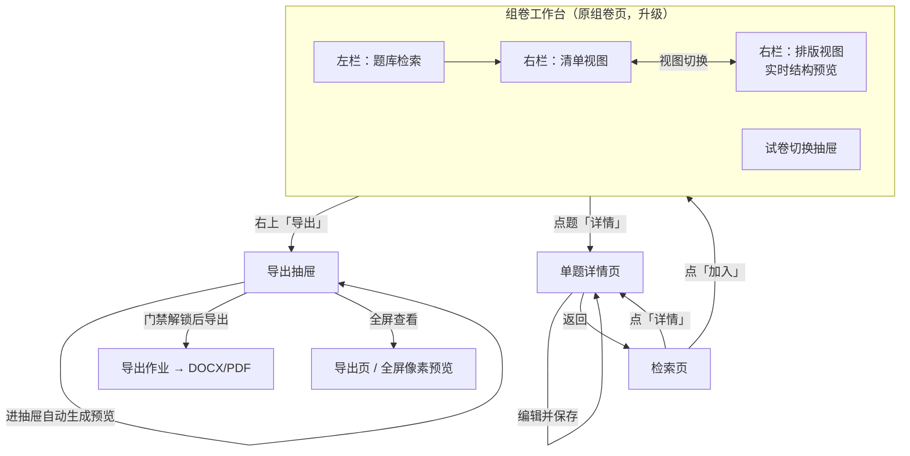
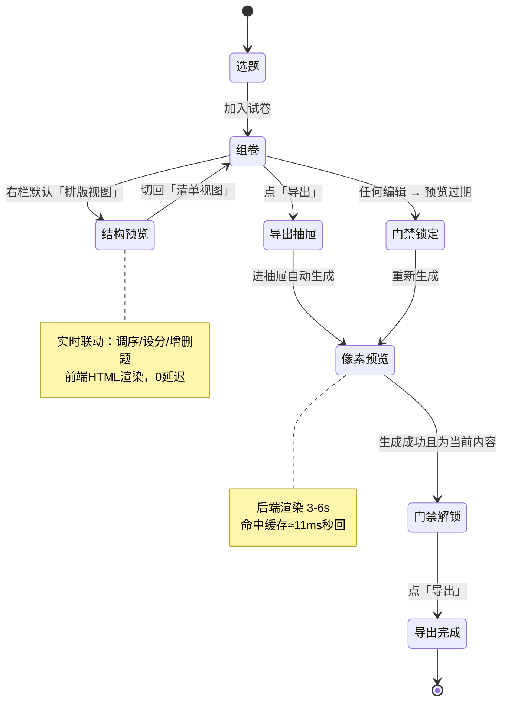

# 题库 Web 界面 · 「从选题到导出」流程重构设计

> 版本：v1.1（据用户 2026-10-07 决策更新：Q1/Q2/Q3/Q8 已确认）｜ 作者：许清楚（产品）｜ 日期：2026-10-07
> 类型：**流程与交互设计（不写代码）**
> 上游依据：`outputs/webui/PRD-题库Web界面.md`、`outputs/webui/架构设计.md`（47 个 API 端点）、`outputs/webui/使用说明.md`、`frontend/src/pages/*`、`frontend/src/store/*`、`frontend/src/api/*`、`bank/paper.py`、`bank/export.py`
> 对标：组卷网（zujuan.xkw.com）/ 学科网 / 二一组卷 的「组卷中心 → 预览 → 下载」流程
> 说明：本文件引用本系统现状处均与上述代码/文档逐项核对；引用组卷网处均标注**检索来源**或**推断**，**不编造**。

---

## 0. 结论速览（先看这段）

1. **组卷网的"预览"不是只读的像素位图，而是"组卷中心"本身——一个「排版预览 + 直接可编辑」的所见即所得工作台**，编辑与预览是**同一个页面**，导出设置在同页右侧面板 / 下载弹窗里。（检索来源，见 §1）
2. 本系统当前把「编辑（组卷页清单）」与「预览（导出页像素位图）」**拆成两个页面**，且像素预览需**手动点击 + 等 3–6 秒**、**只读**。这是与组卷网最大的形态差异。
3. **本次重构的核心决策**：引入**双层预览**——
   - **结构预览（实时、前端渲染、可编辑）**：下沉到「组卷工作台」右栏「排版视图」（**默认视图**），随编辑**自动实时**更新，承担"所见即所得"；
   - **像素预览（后端渲染、只读、3–6s）**：移入**导出抽屉**，作为**导出的强制门禁**（必须先看过**当前内容**的像素预览才能导出），保留现有内容指纹缓存。
   一句话：**"边组边看"用结构预览，"导出前定稿"用像素预览，且导出前必须定稿。**
4. **不改后端能力**：四阶段流程全部可用现有 **47 个端点**实现，**无需新增端点**（见 §8.3）。
5. **不新增页面**：把结构预览内嵌进组卷页、把导出设置收进抽屉；导出页保留为"全屏像素预览 / 导出中心"。9 个页面数量不变。

### 0.1 用户已确认的 4 项决策（2026-10-07 用户答复）

| 编号 | 问题 | 用户决策 | 与本方案默认倾向 |
|---|---|---|---|
| **Q1** | 结构预览放哪 | **内嵌组卷页**（右栏视图切换） | ✅ 一致 |
| **Q2** | 近似排版是否可接受 | **接受双层预览** | ✅ 一致 |
| **Q3** | 导出前是否强制预览 | **强制先预览**（必须先看过像素预览才能导出） | ⚠️ 与"不强制"倾向相反，已按用户决策细化（见 §5-Q3） |
| **Q8** | 组卷页右栏默认视图 | **排版视图** | ⚠️ 与"默认清单"倾向相反，已按用户决策细化（见 §5-Q8） |

> 其余问题（Q4/Q5/Q6/Q7/Q9/Q10）由产品判断并给出方案与理由，见 §5 与 §9。

---

## 1. 组卷网「导出试卷前预览」逻辑调研结论

> 检索时间：2026-10-07。检索对象：组卷网（zujuan.xkw.com）及同族产品（学科网试题篮、二一组卷、新教育组卷）。逐条标注【检索】/【推断】。

### 1.1 入口在哪：预览不是独立步骤，而是"生成试卷"后的组卷中心【检索】

- 【检索·新教育帮助中心】路径为：**各栏目选题 → 加入"试题篮" → 点击「试题篮 → 生成试卷」→ 确定目录与试卷名称 → 进入"试卷预览页面"**。
- 【检索·二一组卷帮助】在试题篮中点击 **「试卷预览」按钮 → 进入"组卷中心"**；在组卷中心可对**试卷的格式、分数、试题进行调整**。
- 【检索·学科网试题篮教程】"试题篮本身不生成可下载文件，必须**进入组卷中心**设定试卷样式、结构要素与输出参数"，才启动合成。
- **结论**：组卷网的"预览" = **生成试卷后的一个工作页面（组卷中心 / 试卷预览页）**，它是"试题篮"的下一站，**不是悬浮弹层，也不是只读页面**。

### 1.2 预览展示什么：带可编辑/可勾选项的排版预览【检索】

- 【检索·新教育】进入试卷预览页后，"**鼠标点击题目**，可以查看答案和解析、添加类题、改编题目、设置分值、设置选项排列方式、上下调整顺序、删除题目"。
- 【检索·学科网】组卷中心"所有题目自动载入**左侧预览区**；右侧为**设置面板**"。
- 【检索·二一组卷】"在组卷中心，可对试卷的格式、分数、试题进行调整"。
- **结论**：组卷网的预览是**"排版 + 交互"合一的**：左/中是排版结果，题目可直接点、拖、改；右侧是样式/分值/结构设置。

### 1.3 预览里能不能改：能，且是主要编辑入口【检索】

- 可在预览页直接完成：**调序（拖拽）、设分值、删除、改编、查看答案解析、替换相似题、设置选项排列方式**【检索】。
- 右侧可**批量设分、设置试卷样式（主标题 / 装订线 / 誊分栏等结构要素）**【检索】。
- **结论**：组卷网**不需要"回上一步改"**——预览页就是编辑页。

### 1.4 状态如何流转：同页实时联动，无独立"刷新预览"步骤【推断】

- 【推断】上述平台预览用的是**HTML 排版**（浏览器直接渲染题干/公式/图片），而非"先合成 DOCX 再转图片"，因此**编辑后立即反映**，不存在"点刷新、等 3–6 秒"这一环。
- 【检索·学科网】"所有操作均**自动保存，无需二次确认**"（针对试题篮内编排）。
- **结论（推断为主）**：组卷网是**同页实时联动**；缓存/重渲染成本问题在 HTML 渲染下不存在。**这正是本系统像素级方案与它的根本差异**（本系统预览 = 真实 DOCX 渲染，故有 3–6s 成本与指纹缓存）。

### 1.5 导出前有哪些选项【检索】

- **答案显示**：学生版 / 教师版 / 答案版（三种）【检索·新教育】；下载设置中可"确认是否包含答案与解析"【检索·学科网】。
- **结构要素**：主标题、装订线、誊分栏（学科网要求必勾，否则无法触发下载）【检索·学科网】。
- **试卷标题**：手动填写规范名称【检索·学科网】。
- **格式**：非会员仅可选 **B4 横双栏**（存在会员/积分门槛）【检索·学科网】。
- 【推断】常见的还有：纸张/边距/分栏、是否留答题空白、导出 Word/PDF、是否需要登录与积分。
- **结论**：导出设置是**独立于预览的一小组选项**，在**同页右侧面板或下载弹窗**中呈现；**有登录/积分门槛**（本系统是纯本地单机，**无账号/积分**，此点不适用）。

### 1.6 关键交互细节【检索 + 推断】

- 【检索】点击题目标题**展开完整题干**，支持放大查看图形、公式及选项排版。
- 【检索】下载时**系统开始生成 PDF，有进度条**（异步合成）。
- 【推断】分页浏览、缩放、跳页是这类"排版预览"的通用能力；本系统 `PreviewViewer.tsx` 已实现**缩放 + 分页**（1 页一张 A4 白纸）。

### 1.7 异常处理【推断为主】

- 【推断】预览生成失败：一般提示重试；题目缺失/图片加载失败：占位或红字提示，不静默。
- 【推断】题目被"替换相似题"后题序不变（【检索·学科网】明确"原题被无缝替换，题序与标注信息保持不变"）——对应本系统的**快照锁定**语义（改题不影响已组卷）。

### 1.8 一句话总结（本次对标的本质）

> **组卷网把"预览"做成了"组卷中心"：排版即预览、预览即编辑、导出设置同页。**
> 本系统的**像素级预览保真度更高**（与导出逐像素一致），但代价是**慢、只读、需手动触发**。
> **重构思路 = 借组卷网的"实时结构预览（可编辑）"补上"所见即所得"，同时保留本系统"像素预览"作为导出前的最终校验。**

---

## 2. 重构范围（四阶段）

| 阶段 | 本次涉及什么 | 核心变化 |
|---|---|---|
| **① 选题** | 检索、筛选、加入试卷；**加入后的即时反馈与"试卷篮"入口** | 加入后不丢上下文，随时能"去看看试卷"；当前试卷状态更显性 |
| **② 组卷** | 调序、设分、大题分组、试卷元数据；**升级为"组卷工作台"** | 右栏从"纯清单"升级为**「清单 / 排版」双视图**；排版视图 = 实时结构预览 |
| **③ 预览（重点）** | **本次核心** | 拆为**结构预览（实时·可编辑）**与**像素预览（按需·只读）**两层；结构预览下沉到组卷工作台，像素预览移入导出抽屉 |
| **④ 导出** | 模板/答案模式/格式选择、生成、下载 | 从"独立导出页"改为**组卷工作台内的导出抽屉**；像素预览与导出设置同处一个抽屉 |

**边界说明**：本次**不涉及后端能力新增**，四阶段全部由现有 47 端点支撑（见 §8.3）；不改数据库 schema；不引入账号/积分（本系统为纯本地单机）。

---

## 3. 新流程总览

### 3.1 页面流转图（Mermaid）

### 3.2 状态流转图（Mermaid）

### 3.3 两种预览的职责划分（本次最关键的一张表）

| 维度 | **结构预览（新）** | **像素预览（现有，保留）** |
|---|---|---|
| 渲染位置 | **前端**（React + KaTeX + CSS 分页） | **后端**（DOCX → PDF → PNG，`pypdfium2`） |
| 保真度 | **近似排版**（用于确认内容/结构/题号/分值） | **与导出逐像素一致**（用于最终定稿） |
| 耗时 | **实时**（编辑即更新，防抖 200–300ms） | **首次 3–6 秒**；同内容命中缓存≈秒回 |
| 可编辑 | **可**（拖拽调序、点题改分、删除） | **否**（位图只读） |
| 触发 | **自动**（切到排版视图即渲染） | **进导出抽屉自动生成**（未命中缓存时起作业，可重试） |
| 位置 | 组卷工作台右栏「排版视图」 | 导出抽屉内 |
| 数据来源 | `GET /api/papers/{id}/export-data`（快照） | `POST /api/papers/{id}/preview` → job |
| 失效 | 随前端状态即时重算 | 内容变化 → **标记过期 + 重新锁定导出**（见 §5-Q3） |
| 与导出的关系 | 辅助确认（不设门禁） | **强制门禁**：过期即锁，重新生成才能导出 |

---

## 4. 各阶段详细设计

### 4.1 选题阶段

**用户操作路径**
1. 进「检索页」→ 输入关键词（现有中文双字切分，6–13ms）→ 左侧筛选栏收窄。
2. 结果卡点「加入」→ 加入当前试卷（若当前无试卷，弹「选择/新建试卷」对话框，现有 `PickPaperDialog`）。
3. 加入成功后，结果卡出现**「已加入 · 去看看试卷 →」**的轻量入口（**新增交互**），点击直达组卷工作台对应试卷。

**页面流转**：检索页 ⇄ 单题详情页；检索页 →（加入）→ 组卷工作台。

**状态管理**

| 状态 | 存放 | 刷新后是否保留 |
|---|---|---|
| `currentPaperId`（当前试卷） | `paperStore`（zustand + localStorage） | **保留** |
| `targetSectionId`（加入目标大题） | `paperStore` | **保留** |
| 关键词 / 筛选 / 分页 | 组件 `useState`（建议改写入 URL query，见 §4.2） | 现状**丢失**；建议**保留** |
| 试卷内容 | **后端**（react-query 缓存） | 重新拉取（以后端为准） |

**触发条件**
- 「加入」为**显式点击**（不做"加入即跳走"，保留刷题节奏）。
- 无当前试卷时**必须**先选/建卷（沿用现有逻辑，不静默新建）。

**数据流转**
- 加入：`POST /api/papers/{id}/questions {question_ids, section_id}` → 返回**整卷** → 前端失效 `['paper', id]`、`['papers']`。
- 检索：`GET /api/search`、`GET /api/search/facets`、`GET /api/meta/coverage`。

---

### 4.2 组卷阶段（升级为「组卷工作台」）

**定位**：对齐组卷网"组卷中心"——**边组边看、所见即所得**。

**用户操作路径**
1. 进「组卷页」（= 组卷工作台）。顶部：试卷切换器、试卷标题、题数/总分/未设分/无答案汇总、「导出」按钮。
2. 左栏：题库检索 + 筛选（现有）。
3. 右栏：**「排版 / 清单」视图切换**（**新增**），**默认「排版视图」**（用户决策 Q8）
   - **排版视图**（**新增**，`LivePreviewPanel`）：A4 分页的**前端近似排版**，含卷头、题号重排、大题标题、分值、答案区、无答案标注——所见即所得；**默认视图**。
   - **清单视图**（现有 `PaperPanel`）：大题分区、行内菜单（上移/下移/移除/设分）、拖拽排序——适合**批量设分、快速调序**。
   - 两视图**共享同一份后端整卷状态**，切换不丢数据；**切换结果记忆**（持久化到 `uiStore`，见 §5-Q8）。
4. **排版视图中可直接编辑**（对齐组卷网）：拖拽调序（`⠿` 手柄）、点分值 chip 就地改分、`✕` 删除（复用 `moveQuestion` / `setScore` / `removeQuestion`），改完立即反映到清单视图。交互细节见 §5-Q8。

**页面流转**：组卷工作台 ⇄ 单题详情页；组卷工作台 →（导出）→ 导出抽屉。

**状态管理**

| 状态 | 存放 | 刷新后 |
|---|---|---|
| 整卷（sections/items/summary） | **后端**（`GET /api/papers/{id}`，react-query） | 重新拉取 |
| 当前试卷 id | `paperStore` | 保留 |
| 右栏视图（清单/排版） | 组件 state（建议持久化到 `uiStore`） | 建议保留 |
| 左栏检索条件 | 组件 state（建议写入 URL query） | 建议保留 |

**触发条件**
- 结构预览：**切到排版视图即渲染**；编辑后**自动更新**（防抖 200–300ms，避免连续拖拽时抖动）。
- 所有写操作**以后端返回整卷为准**（现有约定，架构 §8.7 / §10），前端**不做乐观累加**。

**数据流转**
- 结构预览数据：`GET /api/papers/{id}/export-data?answer_mode=...`（返回 sections + questions，含 `text`(⟦Fn⟧)、`formulas`、`score`、`answer/analysis`、`show_answer/show_analysis`、`source`）→ **直接驱动前端 A4 排版**。✅ 复用现有端点。
- 组卷写操作：`POST/PATCH/DELETE /api/papers/{id}/...`（加题/移题/移动/设分/大题 CRUD）→ 返回整卷。

**"排版视图"渲染要点（前端近似排版，非像素）**
- 卷头：按模板（考试含班级/姓名/学号/成绩；测验含班级/姓名；作业含姓名/班级）。
- 大题标题 + 分值说明；题号**全卷连续重排**。
- 题干 KaTeX 渲染（复用 `KatexFormula`），图片居中；无答案题**逐题标注**。
- 答案区：学生版不含；仅答案附【答案】；答案解析版附【答案】【解析】。
- 明确标注"**近似排版，最终以导出为准**"（与 PRD 3.3 定位一致）。

---

### 4.3 预览阶段（本次核心）

**设计原则**：把"预览"从**一个终点步骤**改为**贯穿组卷的两层能力**。

**（1）结构预览（实时·可编辑）**
- 位置：组卷工作台右栏「排版视图」。
- 触发：**自动**（切视图即渲染；编辑后防抖自动更新）。**无"刷新"按钮**。
- 数据：`GET /api/papers/{id}/export-data`（快照内容）。
- 成本：前端渲染，**0 后端渲染开销**，无 3–6s 等待。
- 可编辑：是（拖拽/改分/删除，写回后端）。

**（2）像素预览（后端渲染·只读·导出强制门禁）**
- 位置：**导出抽屉**内（以及可选的"导出页 / 全屏预览"）。
- 触发：**进导出抽屉即自动开始生成**（老师点导出＝已表达导出意图，无需再点一次）；命中内容指纹缓存时**直接返回 `pages`（≈11ms 秒回）**。
- 数据：`POST /api/papers/{id}/preview {answer_mode, template}` → 命中返回 `{cached:true, pages}`；未命中返回 `{job_id}` → 轮询 `GET /api/jobs/{job_id}` → `page_N.png`（`GET /api/preview/{key}/page_{n}.png`）。
- 展示：沿用 `PreviewViewer`（缩放 + 分页 + "命中缓存"标识）。
- **门禁作用**：只有"**当前内容**已成功生成像素预览"时，导出按钮才解锁（详见 §5-Q3）。

**（3）两者的衔接（强制预览）**
- 老师日常编辑看**结构预览**（快、可改）；点「导出」进抽屉后**自动生成像素预览**，**未生成成功前导出按钮锁定**。
- **过期即重新锁定**：任何编辑（调序/设分/增删题/改模板/改答案模式/刷新快照）都会使内容变化 → 旧预览标记**"已过期"** → 导出按钮**重新锁定**，必须重新生成才能导出。

**页面流转**：组卷工作台 →（点导出）→ 导出抽屉（不离开工作台）；抽屉内「全屏查看」→ 导出页。

**状态管理**

| 状态 | 存放 | 刷新后 |
|---|---|---|
| 结构预览 | 由 `export-data` 派生（react-query） | 重新拉取 |
| 像素预览 `pages` / `key` | 导出抽屉组件 state | 丢失，需重新生成（命中缓存则秒回） |
| **导出门禁 `previewFresh`** | 前端**脏标记**（编辑即置 false，预览成功且内容未再变则置 true），不存储 | 重算（刷新后默认锁定） |
| 导出设置（模板/答案模式/格式） | 组件 state（建议持久化 `uiStore` 或 URL） | 建议保留 |

**触发条件小结**
- **自动**：结构预览（编辑即更新）；像素预览（进抽屉自动生成）。
- **自动失效**：任何影响内容的操作 → `previewFresh=false` → 导出锁定。
- **解锁**：像素预览生成成功 **且** 其后内容未再变化。

---

### 4.4 导出阶段

**用户操作路径**
1. 组卷工作台点右上「导出」→ 打开**导出抽屉**（右侧 `Drawer`，不跳页）。
2. 抽屉顶部：**导出设置**——答案模式（学生版/答案解析版/仅答案）、模板（考试/测验/作业）、格式（DOCX / PDF 复选）。
3. 抽屉中部：**像素预览区**——进抽屉**自动生成**（命中缓存≈11ms 秒回；未命中约 3–6s，有进度提示）。
4. 抽屉底部：**「导出」**按钮（**门禁解锁后才可点**）+ 导出结果（文件路径 / 大小 / 题数 / 页数 / 公式数 / 图片数 / 缓存命中 / 警告）。
5. 「全屏查看」→ 导出页（大屏看像素预览、查看导出历史 P2-6）。

**页面流转**：组卷工作台 → 导出抽屉（内联）→（可选）导出页。

**状态管理**：导出设置、作业状态（`useJob` 轮询）、导出结果、`previewFresh` 门禁——均组件 state；建议导出设置持久化。

**触发条件（强制预览门禁）**
- 进抽屉：**自动开始**生成像素预览。
- 导出：**门禁解锁后**才可点（`previewFresh === true`）；`formats` 为空时同样禁用（现有）。
- **详细门禁机制见 §5-Q3。**

**数据流转**
- 预览：`POST /api/papers/{id}/preview` →（job / cached）。
- 导出：`POST /api/papers/{id}/export {answer_mode, template, formats}` → `{job_id}` → 轮询 `GET /api/jobs/{job_id}` → 结果（含 `docx`/`pdf` 路径、`warnings`）。

---

## 5. 关键设计问题（逐条回答，编号与 §9 一致）

> **Q1 / Q2 / Q3 / Q8 已由用户确认**；Q4–Q7、Q9–Q10 由产品判断给出方案与理由。

### Q1【已确认】结构预览放哪？

**用户决策：内嵌组卷页（右栏视图切换）。**

- 结构预览 = 组卷工作台右栏「排版视图」，**默认视图**。
- 像素预览放**导出抽屉**（不跳页）；如需大屏，抽屉内「全屏查看」进导出页。
- 改完题序**无需离开组卷页**，在排版视图直接看结果。

**理由**：与组卷网/学科网"预览与编辑同页"一致（§1.1–1.3）；本系统原流程"组卷页→导出页→手动生成预览"需 2 次跳转 + 3–6s 等待，与"边组边看"冲突。

### Q2【已确认】近似排版是否可接受？

**用户决策：接受双层预览。**

- 结构预览 = **近似排版**（内容/结构/题号/分值/答案区正确，**不承诺像素一致**）；像素预览 = **逐像素一致**。
- 备选：若日后要求"结构预览也像素级"，则实时联动不可行，须退回"手动刷新像素预览"（届时本方案重做）。

### Q3【已确认】导出前强制预览——门禁机制（**重点**）

**用户决策：必须先看过像素预览才能导出。**

**① 判定条件：是"必须看过「当前内容」的像素预览"，而非"曾经生成过"。**

- 用一个前端**脏标记** `previewFresh` 表示门禁状态：
  - `previewFresh = true` ⟺「**当前试卷内容**已成功生成过像素预览，且其后内容未再变化」；
  - `previewFresh = false` ⟺ 未预览，**或**预览后内容又变了（过期）。
- **导出按钮**：仅 `previewFresh === true` 时可点；否则 disabled + 提示"请先生成/刷新像素预览"。

**② 过期后是否重新锁定？——是，必须重新锁定（关键）。**

- 任何影响内容的操作都会把 `previewFresh` 置 `false`，从而**重新锁定导出**：
  - 组卷编辑：加题 / 删题 / 调序 / 设分 / 大题增删改移 / 刷新快照；
  - 导出设置：切换 `answer_mode` / `template`（会改变渲染结果与指纹）。
- **理由**：若"生成过一次就永久解锁"，老师看过后改题序仍能导出 → **导出的内容与看过的预览不一致**，"强制"形同虚设。用户要的正是"**导出的一定是看过的**"，故**过期必须重新锁定**。
- **实现方式（推荐，零新端点）——"编辑即失效"脏标记**：前端在每次组卷写操作成功后、以及 `answer_mode`/`template` 变化时，**主动置 `previewFresh=false`**；仅在像素预览作业 `done` 且返回后置 `true`。
  - 不依赖前后端指纹逐位一致，判定**必然正确**（编辑必然使内容变化）。
  - 代价：极端情况"改了又改回原样"会多渲染一次（无害）。
  - 因此**无需新增 `fingerprint` 端点**（见 Q5）。

**③ 触发时机：进导出抽屉即自动开始生成。**

- 老师点「导出」＝已表达导出意图，进抽屉**自动**发起像素预览（命中缓存则≈11ms 秒回，几乎无感），无需再点一次"生成预览"。
- 保留「重新生成」按钮用于过期后 / 失败后。

**④ 成本说明（必须写进 UI 文案）。**

- **未改动内容 → 命中缓存 ≈ 11ms 秒回**（实测，架构 §1.5）；
- **改动过内容 → 才需 3–6 秒重新渲染**。
- 文案示例："预览通常秒回；仅当内容有改动时才需约 3–6 秒。"
- 目的：消除老师对"强制预览会很慢"的顾虑。

**⑤ 进度与失败处理。**

- **3–6 秒期间**：进度提示（"正在渲染预览，约 3–6 秒…"）+ 骨架/转圈；导出按钮保持锁定并显示"预览生成中"。
- **生成失败**：导出按钮**保持锁定**，显示错误 + 「重试」；错误文案区分原因（`editor_sdk` 不可用 / Word-WPS 缺失 / 其他）。
- **环境降级逃生（必须处理，否则会锁死导出）**：像素预览依赖 `editor_sdk` 与 Word/WPS（PDF→PNG）。若**Word/WPS 不可用**（此时可导 DOCX、但不能生成 PDF 预览），**强制像素预览会永久锁死 DOCX 导出**。方案：
  - 当像素预览因**环境原因**失败时，提供**降级门禁**——以"**结构预览已确认**"替代像素预览作为门禁，并明确提示"当前环境不支持像素预览，已降级为结构预览确认"；
  - 或提供一次性显式覆盖"仍要导出（风险自负）"。
  - **推荐前者**（自动降级 + 明确告知）：既守住"必须先看过"的意图，又不让系统不可用。

### Q4 预览过期时：旧图保留还是清空？

**方案：保留旧图 + 标"已过期" + 重新锁定导出（与 Q3 串联）。**

- **保留**：旧像素预览图仍可看（便于对照"改了什么"），不制造"改一下就没得看"的焦虑。
- **标记**：预览区顶部加**醒目横幅**："⚠ 内容已变更，此为旧版本预览，导出已锁定"。
- **重新锁定**：`previewFresh=false` → 导出按钮 disabled（见 Q3），必须重新生成才能导出。
- **串联逻辑**：保留的是"**看的对象**"，锁定的是"**导出的资格**"——两者不矛盾：老师仍能看旧图，但**不能拿旧图当依据导出**。

**理由**：清空旧图会让老师失去参照且体验突兀；保留 + 过期横幅 + 重新锁定，兼顾"可参考"与"不误导"，且完全满足 Q3 的强制语义。

### Q5 是否需要 `GET /api/papers/{id}/fingerprint` 端点？

**方案：不需要（保持 47 端点不变）。**

- 采用 Q3 的**"编辑即失效"脏标记**，前端无需知道后端 `cache_key`，**不依赖指纹逐位一致**，故无需该端点。
- `key`（后端 cache key）仅用于展示"命中缓存"徽章（现有响应已含 `key`）。
- 若未来要求"精确指纹对比"（如多标签页协同），再评估新增；**当前不新增**。

### Q6 检索条件 / 导出设置是否写入 URL？

**方案：检索条件写入 URL；导出设置按性质分开处理。**

- **检索条件（关键词/筛选/分页）→ 写入 URL query**（检索页 + 组卷工作台左栏）。理由：刷新、浏览器前进/后退、分享链接都能保留，便于"回到上次的检索状态"。
- **导出设置**：
  - `template` / `answer_mode` 是**试卷属性**，已存在 `papers` 表（`PATCH /api/papers/{id}`）——**以后端为准**，不重复存 URL。
  - `formats`（DOCX/PDF 勾选）是**纯前端偏好**——持久化到 `uiStore`。
- **理由**：状态按"归属"放置，避免多处存储不一致。

### Q7 导出页（P4）保留还是删除？

**方案：保留，但明确其定位为"可选的全屏预览 / 导出中心"（非必经路径）。**

- 结合"强制先预览"重新评估：门禁在**抽屉内**即可完成，导出页**不再是必经步骤**；但它仍有独立价值：
  1. **大屏核对多页排版**（抽屉空间有限，逐页看 A4 不便是痛点）；
  2. **导出历史（P2-6）** 有明确归属；
  3. **不删页面** → 导航不变、改动面小。
- **理由**：删除的收益（少一个页面）小于代价（丢失大屏预览与导出历史、动导航）。保留但**降级为可选增强**。
- 门禁逻辑在抽屉与导出页**共用同一 `previewFresh` 状态**（同一份 react-query 数据派生），两处行为一致。

### Q8【已确认】排版视图交互 + 默认视图（**重点**）

**用户决策：右栏默认「排版视图」。**

**① 排版视图内仍支持拖拽调序、点题改分、删除**（对齐组卷网，见 §1.3）。交互细节：

| 操作 | 入口 | 细节 |
|---|---|---|
| **拖拽调序** | 每题左侧/悬浮的 `⠿` 六点手柄 | 悬停出现手柄；拖动时显示**插入指示线**；放下即调序（复用 @dnd-kit + `moveQuestion`）；**跨大题拖拽暂不支持**（现有 `onDragEnd` 已如此限制，保持） |
| **改分** | 每题右上角**分值 chip**（如 `[3分]` / `[未设分]`） | 点击 chip → 变输入框就地编辑 → 回车/失焦保存（`setScore`）；非法值即时红框提示（后端 `_validate_score`） |
| **删除** | 每题右上角 `✕`（悬停出现） | 点击删除（`removeQuestion`）；**用 undo Toast 兜底**（见 Q9） |
| **看/改题干** | 点击题号/题干 | 跳单题详情页（可编辑）；排版视图**只做排版与调序/分值/删除**，不改题干文字 |

**② 视图切换是否记忆？——记忆（但首次默认排版）。**

- 默认值 = **排版视图**（用户决策）。
- 老师切到「清单视图」后，**记忆上次选择**（持久化 `uiStore.builderView`），下次进组卷页回到清单。
- 即："**首次排版，之后跟随上次**"。理由：默认满足"所见即所得"（用户决策），记忆满足"我习惯清单"的熟练用户。

**③ 是否提供"切到清单视图批量操作"的引导？——提供。**

- 排版视图顶部常驻轻提示："需要**批量调序 / 批量设分**？切到「**清单视图**」更快。［切到清单视图］"。
- 理由：排版视图一屏题少，批量操作效率低于清单视图（team-lead 指出的问题）；用**引导**而非**强制默认清单**，兼顾"所见即所得"与"批量效率"。
- **批量设分**主要放在**清单视图**（选中多题 → 统一设分，复用 `POST /api/papers/{id}/scores`）；排版视图不做批量。

### Q9 排版视图里改分/删除是否要二次确认？

**方案：改分即时（无确认）；删除用 undo Toast 兜底（次选轻确认）。**

- **改分**：即时保存，不确认（高频操作，确认会打断）；错误可再点 chip 改回。
- **删除**：不弹确认框（避免打断），改为**删除后弹 `undo` Toast**（"已移除第 N 题 ［撤销］"，5 秒内可撤销）。
  - 若工程不便实现撤销，则退化为**轻确认**（在 `✕` 上二次点击确认删除）。
- **理由**：删除低频但有破坏性，用"可撤销"比"每次弹窗"更顺滑；改分高频，绝不加确认。

### Q10 窄屏 / 移动端如何降级？

**方案：窄屏（< 1024px）双栏降为单栏 + 视图切换。**

- 左栏（题库）与右栏（试卷）在窄屏改为**单栏**，顶部用 Tab/分段控件切换"题库 / 试卷"。
- 右栏内部「排版 / 清单」切换**保留**（不受窄屏影响）。
- 导出抽屉在窄屏改为**全屏抽屉/页面**。
- **理由**：本系统以桌面为主（双栏是核心体验），窄屏只需"能用"，不做移动端专门优化。

### 附：多份试卷并行（原 §3.3-Q6）

- **沿用后端隔离**：所有试卷数据以 `paper_id` 为键（`GET /api/papers/{id}`），天然隔离。
- **前端 `paperStore` 只管"当前看哪份"**（`currentPaperId`，localStorage 持久化），**不缓存整卷内容**——避免多卷内容在前端打架（现有设计，保持）。
- **像素预览与门禁状态随试卷切换重置**：导出抽屉的 `pages`/`key`/`job_id`/`previewFresh` 均与 `paperId` 绑定，**切卷即重置**，杜绝串卷。
- **试卷切换器**（现有左抽屉）升级为工作台**顶部切换器**，显示每卷"题数/总分/未设分"，一键切换。

**理由**：现状 `paperStore` 设计（只存 id、不存内容）已正确支撑多卷；本次只需在 UI 上**把切换入口做显性**，并在**像素预览/门禁侧做好重置**。

---

## 6. 异常处理策略

| 异常 | 表现（新流程） | 处理 |
|---|---|---|
| **结构预览渲染失败**（KaTeX 报错 / 图片缺失） | 公式降级为**红字源码**（KaTeX `throwOnError:false`）；图片 broken → 占位框 + "图片缺失" | 不阻塞编辑；在题上给**可点标记**，点击跳详情页 |
| **像素预览生成失败 / 超时（3–6s）** | 作业状态 `error` → 抽屉内红色提示；**导出按钮保持锁定** | 提供「重试」；若 `editor_sdk` 不可用，提示属环境问题（50001） |
| **像素预览环境不可用（Word/WPS 缺失，只能导 DOCX）** | 像素预览无法生成（PDF→PNG 依赖 Word/WPS） | **降级门禁**：以"结构预览已确认"替代像素预览作为门禁，明确告知"当前环境不支持像素预览，已降级"（见 §5-Q3⑤） |
| **内容变更导致预览过期** | 旧预览保留 + 横幅"⚠ 内容已变更，此为旧版本预览，导出已锁定" | 导出按钮**重新锁定**；重新生成后方可导出（见 §5-Q3/Q4） |
| **题目在组卷后被修改（快照锁定）** | 该题在清单/排版视图显示**"题库已更新"**标记；汇总区提示"本卷 N 题题库已更新" | 提供「刷新该题到最新版」（`refresh-snapshots`，按卷、非全库）；**默认不静默变更**（沿用 PRD 3.1 / 架构 §8.7） |
| **图片缺失** | 排版视图与像素预览均占位提示；导出 `warnings` 列出 | 不硬造；导出结果区展示 warning |
| **公式渲染失败（导出侧）** | 导出 `warnings` 逐条列出（对应 196 条待复核 / 419 条取不到公式的题） | 引导去「待复核公式」页处理；不阻塞导出 |
| **导出失败 / 桥接不可用** | `50001`；无 Word/WPS 时**降级为只导 DOCX** 并提示（现有行为） | 抽屉内明确"当前环境不支持 PDF，已降级" |
| **浏览器刷新 / 关闭后重进** | 当前试卷 id **保留**（`paperStore`）；整卷内容**重新拉取**；**像素预览需重新生成**（命中缓存则秒回）；筛选/导出设置**建议**写入 URL 保留 | 不丢"在看哪份卷"；不假装有未生成过的预览 |

---

## 7. 与原流程的差异对比表

| 维度 | 原流程 | 新流程 | 为什么改 | 对老师的影响 |
|---|---|---|---|---|
| **预览的形态** | 导出页里**只读的像素位图** | 组卷工作台内**可编辑的结构预览** + 导出抽屉里**只读像素预览** | 对齐组卷网"预览即编辑"；像素只读是技术必然 | 改题序**当场看到排版**，不用来回跳页 |
| **编辑与预览的关系** | **两个页面**（组卷页 / 导出页） | **同页**（组卷工作台内切换清单/排版视图） | 降低跳页成本 | 少跳 2 次页 |
| **组卷右栏默认视图** | 清单（结构化列表） | **排版视图**（所见即所得），可切换且记忆 | 见 Q8 | 进组卷页先看到成卷排版 |
| **预览触发** | **手动**点「生成预览」 | 结构预览**自动实时**；像素预览**进抽屉自动生成** | 平衡所见即所得与渲染成本 | 日常编辑**不用等**；导出前自动生成 |
| **预览等待** | 每次预览 **3–6s**（改一次等一次） | 结构预览 **0s**；像素预览 3–6s（**仅导出前一次**，命中缓存秒回） | 见 Q2 | 组卷过程**几乎无等待** |
| **能否在预览里改** | **不能**（必须回组卷页） | **结构预览能**（拖拽/改分/删除）；像素预览不能 | 见 Q8 | 一个界面完成"组卷 + 预览" |
| **导出入口** | **独立导出页**（跳转） | **导出抽屉**（不跳页）+ 可选全屏导出页 | 减少上下文切换 | 导出时**仍看得到试卷** |
| **导出前是否强制预览** | 默认"先预览再导出"（页面即预览，但预览=像素位图） | **强制**：当前内容未经像素预览 → 导出锁定；**过期后重新锁定** | 见 Q3 | 导出的一定是看过的内容；未改动时命中缓存≈秒回，不慢 |
| **缓存失效表现** | 无明确前端表达（改后需手动重生成） | 像素预览**保留旧图 + 标"已过期" + 重新锁定导出** | 见 Q4 | 清楚知道"这图是不是最新的" |
| **页面数量** | 9 个 | **9 个**（组卷页升级、导出页降级为全屏预览） | 控制改动面 | 导航不变 |
| **后端端点** | 47 个 | **47 个（无新增）** | 复用现有契约 | 无感 |

---

## 8. 落地影响

### 8.1 现有 9 个页面：哪些要改、改什么

| 页面 | 是否改 | 改什么 |
|---|---|---|
| **P1 检索页** `SearchPage.tsx` | **小改** | 加入成功后加**「已加入 · 去看看试卷 →」**入口；检索条件**建议写入 URL**（刷新/回退保留） |
| **P2 单题详情页** `QuestionDetailPage.tsx` | **不改**（可微调） | 返回时回到来源页（组卷工作台/检索页）；编辑态保持 |
| **P3 组卷页** `PaperBuilderPage.tsx` | **重点改** | ① 右栏加**「排版 / 清单」视图切换（默认排版）**；② 新增**实时结构预览**（新组件 `LivePreviewPanel`）；③ 顶部加**试卷切换器 + 导出按钮**；④ 排版视图支持**拖拽调序/改分/删除**；⑤ 排版视图顶部加"切清单视图批量操作"引导 |
| **P4 导出页** `ExportPage.tsx` | **改造** | 定位降级为**「全屏像素预览 / 导出中心」**；导出设置与**强制预览门禁**抽到**导出抽屉** `ExportDrawer`（组卷工作台内），两处共用同一 `previewFresh`；保留导出历史（P2-6） |
| **P5 知识点复核页** `KnowledgeReviewPage.tsx` | **不改** | 与主流程解耦 |
| **P6 待复核公式页** `FormulaReviewPage.tsx` | **不改** | 从排版/导出 warning 可跳入 |
| **P7 来源文件页** `SourcesPage.tsx` | **不改** | — |
| **P8 统计页** `StatsPage.tsx` | **不改** | — |
| **P9 设置页** `SettingsPage.tsx` | **不改** | — |

**新增/调整的前端组件**（不新增"页面"）：
- `components/LivePreviewPanel.tsx`（**新**）：实时结构预览（A4 近似排版，复用 `KatexFormula`）。
- `components/ExportDrawer.tsx`（**新**）：导出设置 + 像素预览 + 导出按钮 + 结果（从 `ExportPage` 抽取）。
- `components/PaperSwitcher.tsx`（**新/改造**）：顶部试卷切换器（基于现有左抽屉 `Drawer` 逻辑）。
- 复用不改：`PreviewViewer.tsx`、`PaperPanel.tsx`、`FilterSidebar.tsx`、`QuestionCard.tsx`、`StatusBadges.tsx`。

**状态层调整**：
- `paperStore.ts`：保持"只存 `currentPaperId` / `targetSectionId`"；**不缓存整卷**。
- `uiStore.ts`：**新增** `builderView: 'list' | 'layout'`（右栏视图，持久化）；可选新增导出设置持久化。

### 8.2 是否需要新增页面

**不需要（已确认）。** 用户已确认 Q1=内嵌组卷页；结构预览内嵌组卷页、导出设置与门禁收进抽屉；导出页保留（Q7）。**页面总数仍为 9**，导航结构不变。

### 8.3 是否需要新增端点

**无需新增。** 四阶段全部由现有 47 端点覆盖：

| 需求 | 复用端点 |
|---|---|
| 结构预览数据 | `GET /api/papers/{id}/export-data`（#27） |
| 整卷读取 | `GET /api/papers/{id}`（#14） |
| 组卷写操作 | #17–#26（加题/移题/移动/设分/大题 CRUD/刷新快照） |
| 像素预览 | `POST /api/papers/{id}/preview`（#28）+ `GET /api/jobs/{job_id}`（#30）+ `GET /api/preview/{key}/page_{n}.png`（#31） |
| 导出 | `POST /api/papers/{id}/export`（#29） |

**关于"强制预览门禁"是否需要新端点：不需要。**

- 门禁状态用前端**脏标记** `previewFresh`（§5-Q3②）：任何组卷编辑 / 导出设置变化即置 `false`，预览成功且内容未再变才置 `true`——**不依赖前后端指纹逐位一致**，故**无需 `GET /api/papers/{id}/fingerprint`**（见 §5-Q5）。
- 唯一需注意的环境依赖：像素预览需要 `editor_sdk` + Word/WPS；不可用时走**降级门禁**（见 §5-Q3⑤ / §6），**不引入新端点**。
- 结论：**端点数量保持 47 个不变。**

---

## 9. 决策状态

### 9.1 已确认（用户答复，2026-10-07）

| # | 问题 | 用户决策 |
|---|---|---|
| **Q1** | 结构预览放哪 | **内嵌组卷页**（右栏视图切换） |
| **Q2** | 近似排版是否可接受 | **接受双层预览** |
| **Q3** | 导出前是否强制预览 | **强制先预览**（门禁机制见 §5-Q3） |
| **Q8** | 组卷页右栏默认视图 | **排版视图** |

### 9.2 产品已裁定（不再问用户，理由见 §5）

| # | 问题 | 产品裁定 |
|---|---|---|
| **Q4** | 像素预览过期时旧图保留还是清空 | **保留旧图 + 标"已过期" + 重新锁定导出**（与 Q3 串联） |
| **Q5** | 是否需要 `fingerprint` 端点 | **不需要**（用"编辑即失效"脏标记） |
| **Q6** | 检索条件 / 导出设置是否写入 URL | 检索条件**写入 URL**；`template/answer_mode` 以后端为准；`formats` 存 `uiStore` |
| **Q7** | 导出页保留还是删除 | **保留**，定位为"可选的全屏预览 / 导出中心" |
| **Q9** | 排版视图改分/删除是否二次确认 | 改分**即时**；删除用 **undo Toast**（次选轻确认） |
| **Q10** | 窄屏降级 | 窄屏（<1024px）**双栏降单栏 + 视图切换**；抽屉转全屏 |

### 9.3 仍需实现的工程确认项（非产品决策，供工程师评估工作量）

| # | 事项 | 说明 |
|---|---|---|
| E1 | 前端 A4 近似排版的**分页断点算法** | 避免题目被拦腰截断；需工程师评估实现方式与成本 |
| E2 | 排版视图**拖拽调序**与现有 @dnd-kit 的整合 | 现有 `onDragEnd` 已限制"跨大题不拖"，保持 |
| E3 | **降级门禁**的触发判定 | 依赖像素预览失败的错误码（50001）与原因区分 |
| E4 | **undo Toast** 的实现 | 若工程不便，删除退化为轻确认（见 §5-Q9） |

---

## 10. 风险最高 / 最不确定的 2–3 项

1. **"实时结构预览"的排版还原度与实现成本（最不确定）**
   - 前端要用 HTML/CSS 近似还原 A4 分页、卷头、题号重排、答案区、公式/图片——**分页断点**（避免题目被拦腰截断）与**版式一致性**是难点。
   - Q2 已确认"接受双层预览（近似排版）"，故本方案成立；但若实际观感与导出差距过大，老师仍会倾向依赖像素预览。
   - **缓解**：明确定位为"**近似排版**"（PRD 3.3 已如此定义），只保证"内容/结构/题号/分值/答案区"正确，不承诺像素一致；像素一致交给像素预览。

2. **"强制预览"在环境降级下可能锁死导出（新增，高风险）**
   - 像素预览依赖 `editor_sdk` + Word/WPS；**Word/WPS 不可用时只能导 DOCX、且无法生成像素预览**——若不加处理，"强制预览"会把 DOCX 导出也锁死。
   - **缓解**：实现**降级门禁**（像素预览因环境原因失败时，以"结构预览已确认"替代门禁并明确告知），见 §5-Q3⑤ / §6。**这是本方案必须落地的一环，否则"强制预览"会变成"不可用"。**

3. **组卷页改动的回归风险（高风险）**
   - `PaperBuilderPage.tsx` 是当前最复杂的页面（双栏 + 拖拽 + 大量写操作），加"排版视图 + 可编辑 + 默认排版"会扩大状态面。
   - **缓解**：**坚持"以后端整卷为准、前端不做乐观累加"**（架构 §10）；两个视图**共用同一份 react-query 数据**，不引入第二份状态源；先做"只读结构预览"验证版式，再逐步开放"预览内编辑"。

> 次要风险：**"双层预览 + 强制门禁"的心智负担**——老师可能困惑"我该看哪个 / 为什么导出按钮是灰的"。缓解：统一文案（"**排版视图 = 可改，边组边看**" vs "**像素预览 = 定稿，导出前必看**"）+ 过期横幅 + 门禁提示明确指向"下一步该做什么"。

---

*本设计为流程与交互设计，未写代码；引用本系统现状处与代码/文档一致，引用组卷网处已标注检索来源或推断。Q1/Q2/Q3/Q8 已由用户确认，Q4–Q7、Q9–Q10 由产品裁定（§9）。*
